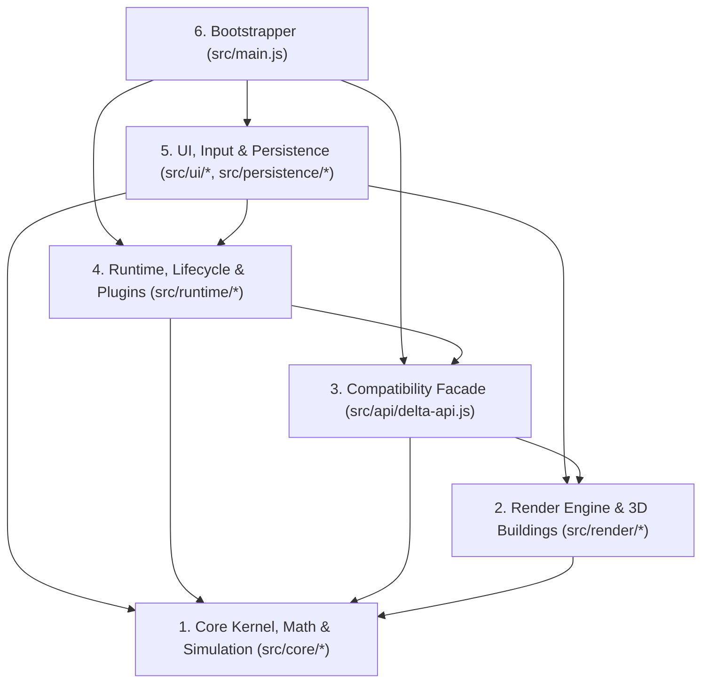
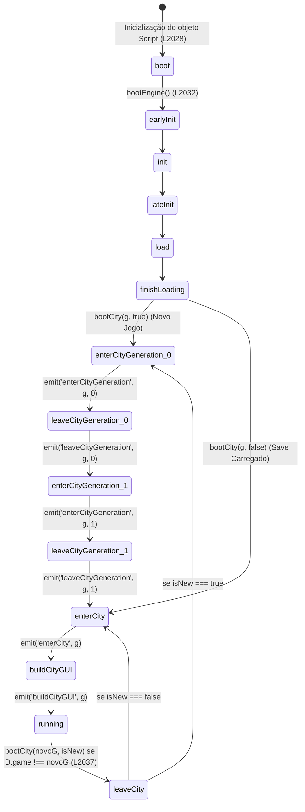

# 01 — Arquitetura Modular e Fluxo de Execução (Delta City)

> **Propósito:** Especificar com determinismo absoluto a arquitetura modular alvo (`src/`), o mapeamento exato de cada bloco do monólito `index.html`, o contrato da fachada global `window.Delta`, a máquina de estados de ciclo de vida (`Delta.Script`), a sequência de inicialização (Boot) e os fluxos de dados ponta a ponta (do evento DOM até a atualização do framebuffer e UI).
> **Referência cruzada:** Consulte `00_INDEX_AND_GLOSSARY.md` para convenções de coordenadas, tipos e glossário.

---

## 1. Visão Geral das Camadas e Regra de Dependência Unidirecional

O sistema é dividido em 6 camadas estritas. Nenhuma camada inferior pode importar ou referenciar símbolos de uma camada superior.



### Regras Estritas de Isolamento:
1. **`src/core/*` (Camada 1 — Pura):** Não conhece DOM (`document`, `window`), não conhece `<canvas>`, não conhece `localStorage` e não conhece o renderizador. Recebe parâmetros primitivos ou objetos de configuração e muta apenas a instância de `Game`.
2. **`src/render/*` (Camada 2 — Visualização Pura):** Importa constantes e funções matemáticas de `src/core/`, lê propriedades de `Game` (`g`) como somente-leitura (com a única exceção de gravar `g.view = { ox, oy, hw, hh }` em `L1525`) e escreve exclusivamente no buffer de pixels `fb` (`Uint8ClampedArray`) e nos caches internos (`_chunks`, `_spr`, `_ttex`, `_emb`, `_lut`).
3. **`src/api/delta-api.js` (Camada 3 — Fachada):** Constrói o objeto `window.Delta` agregando as exportações de `core`, `render` e `runtime`, garantindo 100% de retrocompatibilidade com scripts/plugins escritos para a arquitetura monolítica.
4. **`src/runtime/*` (Camada 4 — Máquina de Estados e Extensões):** Gerencia `Debug`, `Runtime`, `Script`, `Plugins` e o interpretador de comandos `D.run`.
5. **`src/ui/*` e `src/persistence/*` (Camada 5 — Front-end e I/O):** Controla elementos DOM, eventos de ponteiro/teclado, janelas modais, minimapa, `localStorage` e o `requestAnimationFrame(loop)`.
6. **`src/main.js` (Camada 6 — Composition Root):** Importa estilos CSS, inicializa a fachada, dispara o ciclo de boot e registra os listeners globais de janela.

---

## 2. Árvore de Arquivos Completa e Mapeamento Exaustivo (`index.html` → `src/`)

### 2.1 Camada de Estrutura e Configuração (Raiz e HTML)

| Arquivo Alvo | Linhas em `index.html` | Responsabilidade Única e Conteúdo Exato |
|---|---|---|
| `index.html` | `L1–L8`, `L77–L85`, `L2313–L2314` | Documento HTML5 limpo contendo `<head>` (metas mobile/viewport/theme-color `#0b1220`), `<body>` com os containers estáticos (`#stage > canvas#c`, `#top`, `#side`, `#sub`, `#dial`, `#gift`, `#card`, `#cost`, `#bot`, `#clk`, `#money`, `#mm > canvas#mmc`, `#win`) e `<script type="module" src="/src/main.js"></script>`. |
| `src/html/hud.html` | `L80–L84`, `L2121–L2123` | Templates de marcação interna da HUD superior (`#top`), sub-barra (`#sub`), relógio (`#clk`), caixa (`#money`), botão de presente (`#gift`) e barra inferior (`#bot`). |
| `src/html/modal.html` | `L85`, `L2259–L2278` | Estrutura da janela modal `#win > #wb > (#wt + #tabs + #wc)`. |
| `package.json` | *(Novo)* | Configuração npm com scripts `dev` (`vite`), `build` (`vite build`) e `build:single` (bundle monolítico opcional via `vite-plugin-singlefile`). |
| `vite.config.js` | *(Novo)* | Configuração do bundler ES Modules com suporte a build limpo e target `es2020`. |

---

### 2.2 Camada de Estilos (`src/styles/`)

No monólito original, todo o CSS reside em `L9–L76` (68 linhas compactadas). O desmembramento separa por domínio funcional mantendo **exatamente os mesmos seletores, propriedades e especificidade**:

| Arquivo CSS | Linhas Originais | Seletores Contidos |
|---|---|---|
| `src/styles/tokens.css` | `L11` | `:root { --sa: env(safe-area-inset-top); --sb: env(safe-area-inset-bottom); }` |
| `src/styles/base.css` | `L10`, `L12` | `*` (`box-sizing: border-box`, `user-select: none`, `margin: 0`, `padding: 0`), `html, body` (`height: 100%`, `background: #0b1220`, `overflow: hidden`, `font: 700 13px/1.15 Verdana,"DejaVu Sans",sans-serif`, `color: #fff`, `text-shadow` de 5 direções `#031422`). |
| `src/styles/viewport.css` | `L13–L14` | `#stage` (`position: fixed; inset: 0`), `canvas` (`position: absolute; left: 0; top: 0; image-rendering: pixelated; touch-action: none; cursor: crosshair`). |
| `src/styles/components.css` | `L15–L25`, `L67–L72` | `.px` (painel azul borda dupla), `.in` (painel interno escuro), `.pb` (botão pixel-art), `.pb:active`, `.pb.sel`, `.pb.ok`, `.pb.no`, `.pb.sm`, `.pb.big`, `.ic` (ícone 8×8), `.chip`, `.chip.bad`, `.sp`, `.r`, `.r.g`, `.r.b`, `.h`, `.dim`, `.lg`, `.lg.bad`, `.lg.good`, `svg.in`. |
| `src/styles/hud.css` | `L26–L61` | `#top`, `#top>*`, `#top .chip`, `#cN`, `#side`, `#side>*`, `#side .pb`, `#sub`, `#sub .chip`, `#rci`, `#rci .bar`, `#rci .bar i`, `#rci .bar b`, `#dial`, `#dial svg`, `#dial .lbl`, `#gift`, `#card`, `#cost`, `#cost.bad`, `#bot`, `#bot>*`, `#row1`, `#tool`, `#toast`, `#conf`, `#cats`, `#its`, `.cat`, `.item`, `.item small`, `#clk`, `#cD`, `#spd`, `#spd .pb`, `#money`, `#money .chip`, `#money .net`, `#money .net.neg`, `#mm`, `#mm canvas`. |
| `src/styles/modal.css` | `L62–L66` | `#win`, `#wb`, `#wt`, `#tabs`, `#wc`. |
| `src/styles/responsive.css` | `L73–L75` | `@media(max-width:600px)` e `@media(max-height:430px)` com ajustes de posição e tamanho para mobile portrait e landscape. |

---

### 2.3 Camada 1: Core Kernel, Matemática e Simulação (`src/core/`)

Extraída do Script 1 (`L86–L924`):

| Arquivo JS | Linhas Originais | Símbolos Exportados (`export`) | Descrição Técnica |
|---|---|---|---|
| `src/core/constants.js` | `L92–L134`, `L221–L222` | `BIO`, `K`, `KN`, `SIZES`, `FAC`, `CATS`, `CAPM`, `TAXM`, `CLSN`, `DAY_MS`, `SPEEDS`, `POPCAP`, `JOBC`, `JOBI`, `U8`, `D4` | Tabelas estáticas imutáveis de biomas, tipos de construção, metadados de instalações, categorias de ferramentas, multiplicadores de classe/imposto, tempos de simulação e lista de arrays tipados `U8`. |
| `src/core/math/util.js` | `L135–L136`, `L150–L163` | `clamp`, `hash2`, `Util` | Função de saturação `clamp(v,a,b)`, hash espacial determinístico 2D `hash2(x,y,s)` e objeto utilitário `Util` (`collectFullRectTiles`, `collectRectTiles`, `optStorage`, `color2hex`, `hex2color`). |
| `src/core/math/vector.js` | `L139–L149` | `Vector` | Classe `Vector` 3D imutável (`Object.freeze(this)`) com `copy`, `add`, `sub`, `scale`, `dot`, `cross`, `length`, `normalized`. |
| `src/core/math/noise.js` | `L166–L188` | `qnoise`, `fbm`, `ridgedFbm` | Ruído de valor 2D com interpolação quíntica $6t^5 - 15t^4 + 10t^3$ (`qnoise`), Fractional Brownian Motion (`fbm`) e multifractal de cristas (`ridgedFbm`). |
| `src/core/entities/draft.js` | `L191–L198` | `DRAFTS`, `Draft`, `initDefaultDrafts` | Mapa `DRAFTS` e API `Draft` (`append`, `merge`, `getDraft`, `getDrafts`), mais inicialização dos 16 drafts padrão `$b_1` a `$b_16`. |
| `src/core/entities/building.js` | `L200–L215` | `Building` | Wrapper orientado a objetos sobre um tile pivô (`getX`, `getY`, `getXY`, `getDrawXY`, `getWidth`, `getHeight`, `getDraft`, `getText`, `setText`, `hasRoad`, `hasNeededRoad`, `isWorking`, `isUpgradeInConstruction`). |
| `src/core/entities/stubs.js` | `L218–L219` | `NeighborCity`, `DSA` | Stubs da API TheoTown (`NeighborCity`, `DSA`). |
| `src/core/state/game.js` | `L224–L256` | `Game` | Classe principal de estado: construtor (alocação dos 28 `Uint8Array` de `U8`, `pivot`, `cornerH`, `elevF`, `elev`, `bText`, `busy`, `zl`, `bl`, `st`, `veh`, `crimes`, `assign`, `noted`, `cons`, `fx`, `view`), PRNG `rand()`, `dateStr()`, `clock()`, `say()`, `log()`, `ok()`, `pivotOf()`, `isOrigin()`, `getBuilding()`. |
| `src/core/world/terrain-queries.js` | `L258–L306` | Métodos anexados a `Game.prototype`: `getCornerTerrainHeight`, `getTileCorners`, `getTerrainHeight`, `isFlat`, `isSlope`, `isCoast`, `updateSlopeMasks`, `flattenArea` | Consultas de altimetria por vértices $(N+1)\times(N+1)$, cálculo de máscaras de inclinação de 8 bits (`slopeMask`) e terraplenagem (`flattenArea`). |
| `src/core/world/terrain-gen.js` | `L309–L375` | Método `genTerrain(type)` | Geração procedural em 2 fases: Fase 0 (altimetria `elevF` e `cornerH` com Domain Warping, cristas, bacia metropolitana central, rio senoidal ou lago circular) e Fase 1 (umidade `moisture` e classificação em `BIO.WATER`, `BIO.HILL`, `BIO.FOREST`, `BIO.PLAIN`). |
| `src/core/world/footprint.js` | `L378–L402` | Métodos `placeFootprint`, `clearFootprint` | Alocação e limpeza de pegadas multi-tile ($1\times1$, $2\times2$, $3\times3$) com terraplenagem automática, registro de `pivot[i]`, `bSize[piv]` e início de obra em `this.cons`. |
| `src/core/world/starter.js` | `L405–L446` | Método `starter()` | Construção da cidade inicial no centro $c = N \gg 1$: terraplenagem $16\times16$ em altura $2$, grade de avenidas, `MEGA` $3\times3$, `SKY_COM`, `SKY_RES`, `LANDMARK`, usinas, serviços, parques e anel RCI $1\times1$. |
| `src/core/tools/tools.js` | `L449–L451` | Métodos `tool`, `setTool`, `setCursor` | Seleção da ferramenta ativa em `CATS[this.cat].items[this.item]` e posicionamento do cursor `(cx, cy)`. |
| `src/core/tools/selection.js` | `L452–L469`, `L494–L500` | Métodos `tilesOf`, `selBegin`, `selMove`, `selCancel` | Cálculo dos tiles abrangidos por seleção `point`, `line` (ortogonal maior eixo) ou `area` (retangular). |
| `src/core/tools/placement.js` | `L470–L493`, `L501–L533` | Métodos `cost1`, `buildPreview`, `selEnd`, `place` | Cálculo de custo unitário (incluindo sobretaxa de encosta `+$6`, floresta `+$5`, ponte `4x`, colina `2x`), validação de orçamento/terreno e efetivação da construção ou demolição. |
| `src/core/tools/inspect.js` | `L534–L568` | Métodos `inspect`, `popAt`, `jobsAt`, `newCons`, `puff` | Inspeção textual de tile/pivô, cálculo de população e empregos ativos por edifício e emissão de partículas visuais (`fx`). |
| `src/core/sim/network.js` | `L569–L640` | Métodos `isZone`, `isSky`, `spread`, `net`, `near3`, e metade 1 de `recalc` | Propagação radial de cobertura (`spread`), BFS 8-conectado de malha elétrica/hídrica (`net`), detecção de proximidade $3\times3$ (`near3`), propagação de `roadAdj` multi-tile e distribuição proporcional/determinística de energia (`pwOn`) e água (`wtOn`). |
| `src/core/sim/happiness-demand.js` | `L640–L673` | Metade 2 de `recalc` e `riskAt` | Cálculo de valor da terra (`land`), classificação social (`cls`), felicidade por prédio (`hap`) e global (`happy`), demandas RCI (`demand.r/c/i`), desemprego (`unemp`), aprovações políticas (`apP`, `apR`) e risco local de protesto/crime (`riskAt`). |
| `src/core/sim/clock.js` | `L676–L691` | Métodos `update`, `dayTick` | Avanço de animação (`anim`), partículas (`fx`), ciclo solar (`tod`), progresso de obras (`cons`), acumulador de dias (`acc >= DAY_MS`) e decaimento diário de manchas de crime (`cr[i]--`). |
| `src/core/sim/economy.js` | `L692–L716` | Método `monthTick` | Fechamento mensal: arrecadação `tr`, `tc`, `ti`, custo de manutenção `up` corrigido pela inflação, cálculo da inflação (`inflation`), rendimento do caixa (`rent`) ou juros da dívida (`debt`), gravação de histórico (`hist`) e checagem de falência (`funds < -5000`). |
| `src/core/sim/growth.js` | `L719–L744` | Métodos `tryCoalesceSkyscraper`, `growth` | Evolução diária de lotes RCI (construção inicial, fuga de capital da Elite se `tax.r > 18`, abandono após 4 dias sem infraestrutura, upgrade de nível $1\to2\to3$, fusão $2\times2$ de prédios nível 3 em arranha-céus `SKY_RES`/`SKY_COM` e downgrade por infelicidade/demanda negativa). |
| `src/core/sim/events.js` | `L747–L809` | Métodos `riotDay`, `fireDay`, `crimeDay` | Simulação diária de protestos/greves (com risco de barricadas em chamas após 12 dias), ignição/propagação/combate/destruição por incêndios e geração/expiração de crimes com cálculo de `crimeIdx`. |
| `src/core/sim/vehicles.js` | `L812–L884` | Métodos `dispatch`, `nextNode`, `endVeh`, `retreat`, `moveVehicles`, `spawnCars` | Pathfinding BFS reverso sobre ruas do alvo até a delegacia/bombeiro disponível mais próxima (`busy[s] < 2`), controle de tráfego com redução de velocidade por engarrafamento (`0.85x`), trabalho no local e geração contínua de carros civis (`spawnCars`). |
| `src/core/state/persistence.js` | `L887–L909` | Métodos `toJSON` e `Game.fromJSON` | Serialização do estado no schema `v: 5` e desserialização com migração automática de saves `v: 4` (reconstrução de `pivot` e `bSize`). |

---

### 2.4 Camada 2: Motor de Renderização e Biblioteca 3D (`src/render/`)

Extraída do Script 2 (`L925–L1422`) e Script 3 (`L1423–L1997`):

| Arquivo JS | Linhas Originais | Símbolos Exportados (`export`) | Descrição Técnica |
|---|---|---|---|
| `src/render/buildings/palettes.js` | `L934–L949` | `sh`, `mix`, `pick`, `mat`, `FONT`, `C`, `NAMES` | Funções de sombreamento/mistura RGB, fonte matricial $3\times5$ (`FONT`), paletas de cores de paredes/telhados/vidros (`C`) e nomes comerciais (`NAMES`). |
| `src/render/buildings/primitives.js` | `L950–L1053` | `makePrimitives(X)` | Gerador de primitivas 3D isométricas no espaço local do tile $(u,v \in [-0.5, 0.5], z)$: projeção `P`, polígono `Q`, fecho convexo `hull` (Monotone Chain), `shadow`, bloco `blk`, face `FP`/`fq`, janelas `wins`, `door`, `awning`, telhados `gable`/`hip`/`flatRoof`, `cyl`, `cone`, `disk`, letreiro `txt`, `lampPost`, `fence`, `person`, `smoke`, `minicar`, `sign`, `tree`. |
| `src/render/buildings/construction.js` | `L1054–L1081` | `constructionSite`, `crane` | Andaimes, tapumes, fundação e guindaste giratório para prédios em construção (`cons`). |
| `src/render/buildings/residential.js` | `L1082–L1139` | `res1`, `res2`, `res3` | Modelos procedurais residenciais (casas térreas/sobrados, prédios médios e torres residenciais com piscina/quadra). |
| `src/render/buildings/commercial.js` | `L1140–L1181` | `com1`, `com2`, `com3` | Modelos comerciais (lojas de esquina/cafés, escritórios/shopping e arranha-céu comercial com heliponto). |
| `src/render/buildings/industrial.js` | `L1182–L1214` | `ind1`, `ind2`, `ind3` | Modelos industriais (galpões logísticos, fábricas com chaminés fumegantes e complexo petroquímico com esferas/chama). |
| `src/render/buildings/services.js` | `L1215–L1300` | `police`, `fire`, `hosp`, `school`, `coal`, `solar`, `wtower`, `park` | Modelos de delegacia (com helicóptero/viatura), bombeiros (torre de treino/sirene), hospital (cruz vermelha/ambulância), escola (quadra/torre do relógio), termoelétrica a carvão, parque solar, caixa d'água e parque urbano. |
| `src/render/buildings/skyscrapers.js` | `L1301–L1394` | `skyRes`, `skyCom`, `megaTower`, `landmark` | Edifícios monumentais multi-tile: Condomínio Imperial $2\times2$ (torres gêmeas + skybridge), Torre Corporativa $2\times2$ (torre piramidal escalonada), Mega Center Delta $3\times3$ (supertall com 4 torres de apoio) e Torre Panorama $2\times2$ (agulha com observatório giratório). |
| `src/render/buildings/registry.js` | `L1395–L1422` | `make`, `DRAW`, `HEIGHT`, `BOX` | Compõe `Delta.buildings.make(X)`, mapeia `DRAW[k]`, `HEIGHT[k]`, `BOX[k]`, despacha `drawAt(t)` (com clipping progressivo de obra `setClip`) e desenha partículas `fx(f)`. |
| `src/render/raster/pixel.js` | `L1431–L1474`, `L1514–L1515` | `sh`, `mix`, `setClipY`, `setEraseMode`, `fillPoly`, `put`, `erasePoly`, `line` | Primitivas de rasterização em software sobre `Uint8ClampedArray` / `Uint32Array`: scanline polygon filler com dither/alpha (`fillPoly`), oclusão emissiva (`erasePoly`), linha de Bresenham (`line`) e escrita de pixel (`put`). |
| `src/render/raster/terrain-texture.js` | `L1475–L1513` | `terrainTex`, `terrTri` | Geração da textura tileável $256\times256$ por semente (`terrainTex`) e rasterizador de triângulos com interpolação Gouraud de cor/rugosidade/coordenadas de mundo em ponto fixo (`terrTri`). |
| `src/render/raster/caches.js` | `L1480`, `L1539`, `L1702`, `L1757`, `L1893` | `getTerrainCache`, `getChunkCache`, `getSpriteCache`, `getEmissiveBuffer`, `getNightLut` | Gerenciamento centralizado dos buffers e caches de renderização (anteriormente pendurados em `D._ttex`, `D._chunks`, `D._spr`, `D._emb`, `D._lut`). |
| `src/render/camera.js` | `L910–L921`, `L1522–L1525` | `ZL`, `computeView`, `screenToTile` | Quantização de zoom `ZL`, cálculo de `ox, oy, hw, hh, U, elevPx`, projeção `T(x,y)` e inversão iterativa `screenToTile(sx,sy)`. |
| `src/render/terrain-pass.js` | `L1554–L1755` | `renderTerrainPass` | **Passe 1:** iluminação por vértice com normais 3D (`Vector`), escolha de diagonal por menor diferença de cota, saias rochosas estratificadas, ondas na água, tubulações subterrâneas, heatmaps e cache de chunks $8\times8$ com máscara de sombra em stencil (`fillShadowMask`). |
| `src/render/object-pass.js` | `L1756–L1867` | `renderObjectPass` | **Passe 2:** baking e blitting por spans opacos (`buildSpans`, `bakeSprite`, `blitSprite`) de prédios $1\times1$, $2\times2$, $3\times3$, árvores e rochas em ordem de profundidade $(x+y)$, com oclusão da camada emissiva, seguido de estradas, postes, veículos, incêndios, protestos e semáforos em foreground (`roadFG`). |
| `src/render/selection-pass.js` | `L1868–L1888` | `renderSelectionPass` | **Passe 3:** desenho do cursor 3D acompanhando a elevação dos cantos, área de seleção verde/vermelha e anel octagonal de raio de cobertura (`FAC[k].r`). |
| `src/render/night-pass.js` | `L1889–L1914` | `renderNightPass` | **Passe 4:** aplicação da LUT 32-bits de crepúsculo/noite (`night > 0.18`), composição do buffer emissivo ocluído (`emb32`), halos de postes/faróis e balões flutuantes de alerta (`bubble`). |
| `src/render/effects.js` | `L1516–L1519`, `L1916–L1941` | `ICON`, `ICOLOR`, `bubble`, `flames`, `protest` | Ícones $5\times5$ de alerta em bolha (`bolt`, `drop`, `road`, `fire`, `cop`, `riot`), labaredas animadas (`flames`) e multidão em protesto com faixas/fumaça (`protest`). |
| `src/render/roads.js` | `L1942–L1995` | `pole`, `road`, `roadFG`, `car` | Desenho de postes e cabos de alta tensão (`pole`), vias asfaltadas/pontes estaiadas/faixas de pedestres (`road`), pórticos de semáforos (`roadFG`) e veículos orientados ao longo da rampa (`car`). |
| `src/render/renderer.js` | `L1520–L1553` | `render` | Função mestra `render(g, fb, W, H, view)` que prepara o framebuffer, agrupa veículos por tile (`vb`, `out`) e orquestra os Passes 1, 2, 3 e 4. |

---

### 2.5 Camada 3 e 4: Fachada `Delta` e Runtime (`src/api/` e `src/runtime/`)

Extraídas do Script 4 (`L1998–L2059`):

| Arquivo JS | Linhas Originais | Símbolos Exportados (`export`) | Descrição Técnica |
|---|---|---|---|
| `src/runtime/debug.js` | `L2001–L2006` | `Debug` | `Delta.Debug`: `_info`, `info(v)`, `log(...args)` e `toast(v)`. |
| `src/runtime/runtime.js` | `L2007–L2024` | `Runtime` | `Delta.Runtime`: fila de tarefas adiadas `postpone(fn, delayMS)` / `flush(dtMS)`, `storage`, `getStorage(id)`, `registerCommand(n, f)`, `toJson`, `fromJson`, `getTime`, `getUuid`. |
| `src/runtime/script-lifecycle.js` | `L2025–L2049` | `Script`, `guard` | Máquina de estados determinística `Delta.Script` (`EV`, `phase`, `on`, `emit`, `bootEngine`, `bootCity`) e disjuntor de proteção `guard` (desativa plugin após 5 exceções). |
| `src/runtime/plugins.js` | `L2050–L2051` | `Plugins` | Registro de plugins `Delta.Plugins` (`list`, `add`, `setActive`). |
| `src/runtime/console.js` | `L2052–L2057` | `run`, `initDefaultCommandsAndPlugins` | Executor `Delta.run(line)`, comandos nativos (`speed`, `funds`, `interest`, `plugins`) e plugin nativo `$diario00`. |
| `src/api/delta-api.js` | `L87–L90`, `L923`, `L928–L930`, `L1425–L1427` | `Delta`, `installGlobalDelta` | Monta o objeto `Delta` com exatamente todas as propriedades esperadas por código legado e o expõe em `window.Delta`. |

---

### 2.6 Camada 5 e 6: UI, Persistência e Bootstrap (`src/ui/`, `src/persistence/`, `src/main.js`)

Extraídas do Script 5 (`L2060–L2311`):

| Arquivo JS | Linhas Originais | Símbolos Exportados (`export`) | Descrição Técnica |
|---|---|---|---|
| `src/ui/config.js` | `L2064`, `L2067–L2068` | `KEY`, `SET`, `cfg`, `loadConfig` | Chaves `delta_city_v4` e `delta_city_v4_set`, detecção de tela de toque (`pointer:coarse`) para `cfg.confirm`. |
| `src/ui/dom.js` | `L2063`, `L2069–L2070`, `L2279` | `$`, `el`, `cl`, `Q` | Utilitários DOM: busca por ID `$`, criação de elemento `el`, sanitizador de emojis `cl` e iterador `Q`. |
| `src/ui/icons.js` | `L2081–L2119` | `SPR`, `COL`, `iconUrl`, `ic`, `CATI`, `ITI`, `itIc` | Gerador de ícones pixel-art $8\times8$ via `<canvas>` offscreen convertidos para Data URL PNG cacheados em `IC`. |
| `src/ui/hud.js` | `L2120–L2187` | `initHud`, `hud`, `hudExtra`, `togPerf`, `selectItem` | Montagem inicial da HUD, atualização com dirty-checking por `_k` (`set`), medidor SVG semicircular (`#dial`), barra lateral, overlay de performance (`#perf`) e renderização do minimapa (`#mmc`, intervalo de 400 ms). |
| `src/ui/build-menu.js` | `L2188–L2205` | `initBuildMenu`, `toggleMenu`, `pickCat`, `buildItems`, `showConf`, `hideConf` | Controle do menu de categorias (`#cats`), subitens (`#its`) e botões de confirmação mobile (`#bOk`, `#bNo`). |
| `src/ui/input.js` | `L2164`, `L2206–L2247` | `initInput`, `camClamp`, `panBy`, `showInfo` | Mapa de ponteiros ativos (`ptr`), estados `'pan'`/`'pinch'`/`'sel'`, zoom por roda do mouse e pinça, navegação no minimapa, card de inspeção (`#card`) e atalhos de teclado (setas, `WASD`, `1`–`9`, `Espaço`/`Enter`, `Escape`, `+`/`-`, `f`, `h`, `p`, `b`). |
| `src/ui/modals.js` | `L2248–L2286` | `NG`, `NGO`, `openModal`, `closeModal`, `drawModal`, `spark` | Janela modal com 4 abas (`budget`, `stats`, `log`, `new`), gráficos sparkline SVG e controles de impostos/juros/novo mapa. |
| `src/persistence/storage.js` | `L2072–L2074`, `L2304`, `L2308` | `newGame`, `load`, `save`, `loadPluginStorage`, `initAutoSave` | Persistência síncrona em `localStorage` (`KEY`, `KEY + '_st'`, `SET`), autosave a cada `15000` ms e salvamento em `visibilitychange` / `pagehide`. |
| `src/ui/app-loop.js` | `L2065–L2066`, `L2075–L2079`, `L2287–L2303` | `uiState`, `resize`, `loop`, `startLoop` | Estado compartilhado de câmera/viewport (`W, H, hwF, u0, v0, dirty, heatI, perf`), redimensionamento adaptativo (`s = Math.max(1, Math.ceil(r.width / 640))`) e laço principal `loop(t)`. |
| `src/main.js` | `L2304–L2310` | *(Entrypoint)* | Ponto de entrada que orquestra toda a inicialização na ordem determinística exata. |

---

## 3. Contrato da Fachada Global (`window.Delta`)

Para que qualquer plugin, comando de console ou script externo funcione de forma idêntica ao arquivo monolítico, `src/api/delta-api.js` monta `window.Delta` com a seguinte estrutura exata:

| Propriedade em `window.Delta` | Tipo | Origem no Monólito | Origem Modular |
|---|---|---|---|
| `Delta.BIO` | `Object` | `L92` | `src/core/constants.js` |
| `Delta.K` | `Object` | `L93–L96` | `src/core/constants.js` |
| `Delta.KN` | `Array<string>` | `L97–L101` | `src/core/constants.js` |
| `Delta.FAC` | `Object` | `L103–L109` | `src/core/constants.js` |
| `Delta.CATS` | `Array<Object>` | `L110–L132` | `src/core/constants.js` |
| `Delta.SIZES` | `Object` | `L102` | `src/core/constants.js` |
| `Delta.CLSN` | `Array<string>` | `L133` | `src/core/constants.js` |
| `Delta.Game` | `Class` | `L224` | `src/core/state/game.js` |
| `Delta.Vector` | `Class` | `L139` | `src/core/math/vector.js` |
| `Delta.Util` | `Object` | `L150` | `src/core/math/util.js` |
| `Delta.Draft` | `Object` | `L192` | `src/core/entities/draft.js` |
| `Delta.Building` | `Class` | `L200` | `src/core/entities/building.js` |
| `Delta.NeighborCity` | `Object` | `L218` | `src/core/entities/stubs.js` |
| `Delta.DSA` | `Object` | `L219` | `src/core/entities/stubs.js` |
| `Delta.hash2` | `Function` | `L136` | `src/core/math/util.js` |
| `Delta.clamp` | `Function` | `L135` | `src/core/math/util.js` |
| `Delta.fbm` | `Function` | `L172` | `src/core/math/noise.js` |
| `Delta.buildings` | `{ make, sh, mix, pick, FONT }` | `L929`, `L1421` | `src/render/buildings/registry.js` |
| `Delta.render` | `Function` | `L1426`, `L1996` | `src/render/renderer.js` |
| `Delta.Debug` | `Object` | `L2001` | `src/runtime/debug.js` |
| `Delta.Runtime` | `Object` | `L2007` | `src/runtime/runtime.js` |
| `Delta.Script` | `Object` | `L2026` | `src/runtime/script-lifecycle.js` |
| `Delta.Plugins` | `Object` | `L2050` | `src/runtime/plugins.js` |
| `Delta.run` | `Function` | `L2052` | `src/runtime/console.js` |
| `Delta.game` | `Game \| undefined` | `L2038`, `L2289` | Atualizado em `bootCity` e a cada `loop(t)` |
| `Delta._ttex` | `{ seed, t } \| undefined` | `L1480` | `src/render/raster/caches.js` |
| `Delta._emb`, `Delta._emb8` | `Uint32Array`, `Uint8ClampedArray` | `L1539` | `src/render/raster/caches.js` |
| `Delta._chunks` | `{ m, bytes, t, baked }` | `L1702` | `src/render/raster/caches.js` |
| `Delta._spr` | `{ m, bytes, t, baked }` | `L1757` | `src/render/raster/caches.js` |
| `Delta._lut` | `Uint32Array(768)` | `L1893` | `src/render/raster/caches.js` |

---

## 4. Máquina de Estados de Ciclo de Vida (`Delta.Script`)

Definida em `L2026–L2049`, `Delta.Script` governa a ordem de inicialização da engine, geração/carregamento de cidades e eventos periódicos.

### 4.1 Lista Completa de Eventos (`Delta.Script.EV`, `L2027`)

Existem exatamente **17 eventos** registrados na especificação da engine:
1. `'earlyInit'`
2. `'init'`
3. `'lateInit'`
4. `'load'`
5. `'finishLoading'`
6. `'enterCityGeneration'`
7. `'leaveCityGeneration'`
8. `'enterCity'`
9. `'buildCityGUI'`
10. `'leaveCity'`
11. `'nextDay'`
12. `'nextMonth'`
13. `'nextYear'`
14. `'update'`
15. `'build'` *(registrado em `EV`, mas nunca emitido pelo código atual)*
16. `'remove'` *(registrado em `EV`, mas nunca emitido pelo código atual)*
17. `'event'` *(registrado em `EV`, mas nunca emitido pelo código atual)*

### 4.2 Diagrama de Transição de Fases (`Delta.Script.phase`)



> **Detalhe Crítico de Implementação (`L2040–L2043`):** Durante `bootCity(g, true)`, a propriedade `D.Script.phase` assume as strings com sufixo de fase `'enterCityGeneration:0'`, `'leaveCityGeneration:0'`, `'enterCityGeneration:1'`, `'leaveCityGeneration:1'`, enquanto o evento emitido para `D.Script.emit(...)` é a string base `'enterCityGeneration'` ou `'leaveCityGeneration'` passando `0` ou `1` como segundo argumento (`x`).

### 4.3 Proteção contra Falhas de Plugins (`guard`, `L2025`)
Cada handler registrado via `D.Script.on(ev, fn, owner)` é invocado através de:
```js
const guard = (o, f, a) => {
  if (o.off) return;
  try {
    f.apply(o, a);
  } catch (x) {
    if (++o.err >= 5) {
      o.off = true;
      console.warn('plugin desativado:', o.id, x);
    }
  }
};
```
- Se um plugin lançar exceção 5 vezes acumuladas (`++o.err >= 5`), sua flag `o.off` torna-se `true` e ele é ignorado em todas as emissões futuras até ser reativado manualmente via `D.Plugins.setActive(id, true)` (que zera `o.err = 0`, `L2051`).

---

## 5. Sequência Determinística de Inicialização (Boot Sequence)

Ao carregar a página, a execução ocorre de forma estritamente síncrona em 12 passos antes do primeiro quadro de animação:

| Passo | Linhas Originais | Ação Executada | Efeito no Estado |
|---|---|---|---|
| **1** | `L92–L198` | Definição das constantes (`BIO`, `K`, `KN`, `FAC`, `CATS`, etc.) e população do mapa `DRAFTS` para cada `k > 0` em `KN`. | `DRAFTS` passa a conter 16 entradas (`$b_1` .. `$b_16`). |
| **2** | `L88`, `L929`, `L1426` | Criação de `window.Delta`, anexação de `Delta.buildings` e `Delta.render`. | Namespace `Delta` disponível com núcleo e motor gráfico. |
| **3** | `L2001–L2057` | Inicialização de `Debug`, `Runtime`, `Script` (`phase = 'boot'`), `Plugins`, registro dos 4 comandos (`speed`, `funds`, `interest`, `plugins`) e adição do plugin `$diario00`. | `H['nextMonth']` recebe o listener de `$diario00`. |
| **4** | `L2065–L2068` | Obtenção do contexto 2D de `canvas#c` (`{ alpha: false }`), inicialização de `cfg.confirm` via `matchMedia('(pointer:coarse)')` e leitura de `localStorage.getItem('delta_city_v4_set')`. | Preferência de confirmação carregada. |
| **5** | `L2121–L2246` | Montagem do DOM interno da HUD (`#top`, `#sub`, `#clk`, `#money`, `#gift`, `#rci`, `#spd`, `#side`, `#perf`, `#cats`), criação do contexto 2D do minimapa (`#mmc`) e registro dos listeners de ponteiro/teclado/modal. | Elementos visuais prontos e interativos no DOM. |
| **6** | `L2304` | Leitura de `localStorage.getItem('delta_city_v4_st')` para `D.Runtime.storage`. | Estado persistente dos plugins restaurado antes do boot. |
| **7** | `L2305` | Chamada `D.Script.bootEngine()`. | Emite `earlyInit`, `init`, `lateInit`, `load`, `finishLoading` com `g = null`. `phase` termina em `'finishLoading'`. |
| **8** | `L2306` → `L2073` | Chamada `load()`: tenta ler `localStorage.getItem('delta_city_v4')`. Se existir e for JSON válido, executa `g = D.Game.fromJSON(...)` e `D.Script.bootCity(g, false)`. Caso contrário, chama `newGame({ size: 48, type: 'lake' })`, que instancia `new D.Game(o)` e chama `D.Script.bootCity(g, true)`. | Instância `g` criada (`D.game = g`), câmera posicionada em `u0 = 0, v0 = g.N`, `phase = 'running'`. |
| **9** | `L2306` → `L2075` | Chamada `resize()`: mede `#stage.getBoundingClientRect()`, calcula o divisor de escala `s = Math.max(1, Math.ceil(r.width / 640))`, define `W` e `H` (`>= 64`), redimensiona o canvas, aloca `img = ctx.createImageData(W, H)` e marca `dirty = true`. | Framebuffer RGBA alocado na resolução interna. |
| **10** | `L2306` | Chamadas `buildItems()` e `hud()`. | Menu de construção oculto e todos os chips da HUD e minimapa preenchidos com o estado inicial de `g`. |
| **11** | `L2307–L2308` | Registro de `window.addEventListener('resize', resize)`, `ResizeObserver(resize)` em `#stage`, `setInterval(save, 15000)`, `visibilitychange` e `pagehide`. | Autosave e responsividade da viewport ativos. |
| **12** | `L2309` | Chamada `requestAnimationFrame(loop)`. | Inicia o laço contínuo de simulação e renderização. |

---

## 6. Fluxos de Dados Ponta a Ponta (Front-end ↔ Core ↔ Render)

### 6.1 Fluxo 1: Laço Principal de Quadro (`loop(t)`, `L2288–L2303`)

```mermaid
sequenceDiagram
    participant RAF as requestAnimationFrame
    participant Loop as UI loop(t)
    participant Game as Core g.update(dt)
    participant Script as Runtime Script / Runtime
    participant Render as Render R(g, img.data, W, H, view)
    participant HUD as UI hud()

    RAF->>Loop: t (timestamp ms)
    Loop->>Loop: D.game = g; dt = Math.min(100, t - last); last = t
    Loop->>Game: g.update(dt) (t0..t1)
    Game-->>Loop: atualiza anim, fx, tod, cons, dayTick/monthTick, moveVehicles
    Loop->>Script: se data mudou: emit('nextDay' / 'nextMonth' / 'nextYear')
    Loop->>Script: emit('update', g); Runtime.flush(dt)
    alt t - lastDraw > 60 || dirty
        Loop->>Render: R(g, img.data, W, H, { hw: hwF, u0, v0, heat: HEATS[heatI] })
        Render-->>Loop: preenche img.data (RGBA) e atualiza g.view
        Loop->>Loop: ctx.putImageData(img, 0, 0) (t1..t2)
    end
    alt t - hudT > 200
        Loop->>HUD: hud() + hudExtra() (minimapa se now - mmT >= 400)
        Loop->>Loop: se perf.on: atualiza #perf (EMA 0.8 / 0.2)
    end
    Loop->>RAF: requestAnimationFrame(loop)
```

**Regras temporais exatas do `loop(t)`:**
1. **Clamping de delta-time (`L2289`):** `dt = Math.min(100, t - last)`. Impede espiral da morte caso a aba fique em background.
2. **Detecção de virada de calendário para plugins (`L2290–L2292`):** A UI constrói `ds = g.day + '/' + g.month + '/' + g.year` (sem zero à esquerda, diferente de `g.dateStr()`). Se `ld` já existe e `ds !== ld.s`, emite `'nextDay'`; se `g.month !== ld.m`, emite `'nextMonth'`; se `g.year !== ld.y`, emite `'nextYear'`. Em seguida atualiza `ld = { s: ds, m: g.month, y: g.year }`.
3. **Throttling de Renderização (`L2293`):** O rasterizador de software roda no máximo a ~16.6 FPS (`t - lastDraw > 60` ms) quando a câmera está parada, mas responde imediatamente (~60+ FPS) a qualquer interação do usuário que marque a variável local `dirty = true`.
4. **Throttling de HUD (`L2294`):** `hud()` roda a cada `> 200` ms (~5 Hz). Dentro de `hudExtra()`, o minimapa só é redesenhado se `performance.now() - mmT >= 400` ms (~2.5 Hz), exceto quando clicado (`mmT = 0`, `L2164`).
5. **Média Móvel Exponencial de Performance (`L2297`):** Quando `#perf` está visível (`perf.on === true`), os tempos de simulação (`perf.s`), renderização (`perf.r`) e UI (`perf.u`) são suavizados por `e(a, b) = a * 0.8 + b * 0.2`.

---

### 6.2 Fluxo 2: Interação de Construção / Demolição (Canvas → Core → Render)

1. **Entrada (`pointerdown` em `canvas#c`, `L2213–L2219`):**
   - Captura o ponteiro (`cv.setPointerCapture(e.pointerId)`), converte coordenadas CSS para coordenadas do framebuffer `p = [(e.clientX - r.left) * W / r.width, (e.clientY - r.top) * H / r.height]` e registra em `ptr.set(e.pointerId, p)`.
   - Se a ferramenta ativa não for `'inspect'` e o botão do mouse não for meio/direito (`e.button !== 1 && e.button !== 2`) e houver apenas 1 dedo (`ptr.size === 1`):
   - Converte tela para tile via `t = g.screenToTile(p[0], p[1])`.
   - Define `mode = 'sel'`, oculta confirmação (`hideConf()`), chama `g.selBegin(t[0], t[1])` e marca `dirty = true` (UI).
2. **Arraste (`pointermove`, `L2220–L2227`):**
   - Enquanto `mode === 'sel'`, calcula `t = g.screenToTile(p[0], p[1])` e chama `g.selMove(t[0], t[1])`.
   - `g.selMove` atualiza `this.sel.x1 = x; this.sel.y1 = y` e invoca `this.buildPreview()` (`L480–L493`), que recalcula `this.preview = { tiles, cost, ok }`.
   - Marca `dirty = true` (UI), fazendo o Passe 3 do renderizador desenhar os losangos de seleção e a HUD exibir `#cost`.
3. **Finalização (`pointerup`, `L2228–L2232`):**
   - Se `cfg.confirm === true` (padrão em dispositivos touch), chama `showConf()`, exibindo os botões `#bOk` e `#bNo`. O clique em `#bOk` chama `g.selEnd()`.
   - Se `cfg.confirm === false` (padrão em desktop), chama `g.selEnd()` imediatamente.
4. **Mutação de Estado (`g.selEnd()`, `L501–L516`):**
   - Revalida `this.buildPreview()`. Se `!pv.cost || !pv.ok`, emite mensagem de erro em `this.say(...)` e aborta retornando `0`.
   - Se for ferramenta `point` com `sz > 1` (arranha-céus/marcos), chama `this.placeFootprint(s.x1, s.y1, it.k, it.sz, false, 3)`.
   - Caso contrário, itera `pv.tiles` e para cada tile válido (`t.c >= 0`) chama `this.place(t.i, it)`.
   - Deduz `this.funds -= pv.cost`, executa `this.recalc()` imediatamente (atualizando redes, coberturas, felicidade, demanda e contadores), atualiza `this.say(...)`, recalcula `this.buildPreview()` e retorna o número de tiles afetados `n`.
   - Como `placeFootprint` ou `place` (via `flattenArea`) incrementa `this.terrainVer++` (`L292`), a assinatura `sigOf` dos chunks $8\times8$ afetados muda, invalidando automaticamente o cache de terreno no próximo `render()`.