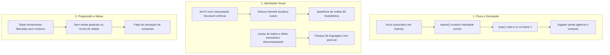

# 00 — Visão Geral, Diagnóstico e Princípios do Projeto

> **Status do Documento:** Planejamento Oficial — Fase de Análise e Especificação  
> **Data:** 30/10/2026  
> **Versão de Referência do Motor:** Delta City v4 (ES Modules, Software Rasterization 2.5D)  
> **Objetivo:** Estabelecer a visão unificada, as metas estratégicas, os problemas centrais identificados e os princípios que guiam a evolução da jogabilidade, do fluxo inicial, da progressão e da identidade visual em pixel art.

---

## 1. Contexto Geral e Missão do Projeto

O **Delta City** é um simulador urbano isométrico 2.5D executado inteiramente em rasterização por software (Software Rasterizer sobre HTML5 Canvas), inspirado nos clássicos simuladores urbanos e na arquitetura do TheoTown, concebido para operar de forma modular, rápida, determinística e sem dependência de motores 3D externos pesados.

Recentemente, a arquitetura monolítica original foi dividida e documentada com rigor matemático nos arquivos [`docs/00_INDEX_AND_GLOSSARY.md`](file:///c:/Users/Carlos/Documents/gittown/docs/00_INDEX_AND_GLOSSARY.md) a [`docs/09_BUILDINGS_CATALOG.md`](file:///c:/Users/Carlos/Documents/gittown/docs/09_BUILDINGS_CATALOG.md).

No entanto, o estado atual do jogo apresenta um descompasso significativo entre a sofisticação da simulação matemática subjacente e a experiência real vivenciada pelo jogador:
1. **O jogo inicializa jogando sozinho:** ao abrir a aplicação, uma metrópole pré-fabricada de grande porte é inserida no mapa e a simulação de tempo, economia, tráfego e serviços entra em execução imediata, sem qualquer intervenção ou decisão do usuário.
2. **Identidade visual inconsistente:** embora concebido sob uma proposta de pixel art, o mundo é rasterizado com superfícies de terreno excessivamente lisas, filtros bicúbicos contínuos e sombreamento Gouraud analógico, criando um visual de computação gráfica poligonal dos anos 90 que entra em atrito com os edifícios e ícones. Além disso, elementos arquitetônicos (como toldos listrados) apresentam frequências gráficas estranhas ao restante do ambiente.
3. **Ausência de jornada e progressão clara:** o jogador é despejado no meio de um sistema já consolidado, sem compreender o objetivo inicial, o significado dos recursos, as consequências das suas primeiras ações ou como desbloquear novas infraestruturas.

A missão desta nova fase de evolução é transformar o Delta City de uma bancada técnica de testes em um **jogo autêntico, intuitivo, envolvente e visualmente coeso**, mantendo integralmente o desempenho, o determinismo e a elegância da arquitetura modular existente.

---

## 2. Problemas Centrais Diagnosticados

### 2.1. Início Prematuro da Simulação e Roubo da Agência do Jogador
Conforme verificado em [`src/core/state/game.js`](file:///c:/Users/Carlos/Documents/gittown/src/core/state/game.js#L40) e [`src/persistence/storage.js`](file:///c:/Users/Carlos/Documents/gittown/src/persistence/storage.js#L29), quando a aplicação abre sem um save prévio no `localStorage`:
- O construtor `new Game()` executa automaticamente o método `this.starter()` ([`src/core/world/starter.js`](file:///c:/Users/Carlos/Documents/gittown/src/core/world/starter.js#L5-L46)), que terraplena uma área central de 16x16 tiles, constrói avenidas, posiciona o arranha-céu *Mega Center Delta* (3x3), usinas, delegacia, hospital, bombeiros, escola, parques e dezenas de edifícios RCI de alta densidade.
- Imediatamente a seguir, [`src/main.js`](file:///c:/Users/Carlos/Documents/gittown/src/main.js#L29) dispara `startLoop()`, que em [`src/ui/app-loop.js`](file:///c:/Users/Carlos/Documents/gittown/src/ui/app-loop.js#L76) executa `g.update(dt)` com velocidade padrão `speed: 1`.
- **Consequência:** O jogador não presencia o terreno virgem, não escolhe onde fundar sua cidade, não planeja as primeiras vias e é forçado a assumir um centro urbano complexo já operando com tráfego, poluição, demandas de infraestrutura e oscilações fiscais.

### 2.2. Conflito Estético e Diluição do Pixel Art
A análise do motor gráfico em [`src/render/raster/terrain-texture.js`](file:///c:/Users/Carlos/Documents/gittown/src/render/raster/terrain-texture.js) e [`src/render/terrain-pass.js`](file:///c:/Users/Carlos/Documents/gittown/src/render/terrain-pass.js) revelou:
- O rasterizador de triângulos de terreno (`terrTri`) utiliza interpolação linear analógica contínua de cores por vértice (Gouraud) e modula os pixels usando um filtro bicúbico Hermite suave (`bil(wx * 0.4 + 7, wy * 0.4 + 3)`).
- Isso produz gradientes esfumaçados e colinas lisas sem degraus de pixel, lembrando renderizadores primitivos de consoles dos anos 90, e não a riqueza de texturas em dither, paletas indexadas e quinas nítidas típicas dos jogos clássicos em pixel art (como evidenciado nas 28 capturas de tela de referência na pasta `imgs/`).
- Em contrapartida, certos edifícios usam primitivas vetoriais proceduralmente geradas com listras alternadas de alta frequência (toldos comerciais em [`src/render/buildings/primitives.js`](file:///c:/Users/Carlos/Documents/gittown/src/render/buildings/primitives.js#L59-L67)), gerando ruído visual e descompasso de resolução (*pixel soup*).

### 2.3. Ausência de Tela de Entrada, Autenticação Inexistente e Falta de Configuração de Mundo
- O jogo carece de um fluxo formal de entrada: não há Tela de Título (*Title Screen*), nem seletor de mundos/regiões, nem controle explícito da semente procedural antes de criar a partida.
- **Auditoria de Autenticação:** Verificou-se no código que não existe qualquer camada de autenticação, login ou senha implementada atualmente. Trata-se de uma aplicação cliente puramente local com armazenamento em `localStorage`. Forçar um sistema de login clássico (inclusive credenciais como `admin/admin`) em um jogo sandbox para navegador representaria fricção injustificada, a menos que planejado para um backend multiusuário online futuro. A solução deve priorizar a simplicidade de perfis locais de prefeito.

### 2.4. Ausência de Estrutura de Objetivos e Curva de Aprendizado
- Uma vez no jogo, todas as ferramentas de construção (de ruas simples a usinas a carvão e arranha-céus colossais de 3x3) estão disponíveis no mesmo menu de forma quase irrestrita, condicionadas apenas pelo saldo bancário.
- Não existem marcos de população (*Milestones / Ranks*), objetivos intermediários ou desbloqueios graduais que celebrem a conquista do jogador à medida que o vilarejo se transforma em vila, cidade e metrópole.

---

## 3. Princípios Fundamentais do Planejamento

Para guiar todas as decisões de gameplay, arquitetura e direção de arte, adotamos os seguintes princípios inegociáveis:

| Princípio | Descrição Prática |
|---|---|
| **1. Agência Total do Jogador** | O jogador é o arquiteto e prefeito. A simulação nunca deve construir a cidade por ele na partida padrão. Cada quarteirão, usina e serviço deve ser fruto de decisões deliberadas do usuário. |
| **2. Separação Estrita: Geração vs. Simulação** | A geração do relevo, biomas e hidrografia é um ato de criação de mundo estático e determinístico. A simulação é um processo dinâmico de regras sociais e econômicas. O mundo deve abrir completamente gerado, porém **obrigatoriamente pausado (`speed: 0`)**, até que o jogador ordene seu início. |
| **3. Coerência Absoluta de Pixel Art** | Toda a tela obedece à mesma grade de resolução virtual. Não haverá mistura de gradientes Gouraud contínuos ou filtros bicúbicos suaves com sprites pixelados. O terreno, a água, a vegetação, os edifícios e os veículos compartilharão iluminação consistente, paletas de cores calibradas e texturas em pixel art com dithering estruturado. |
| **4. Progressão Guiada sem Perda de Liberdade** | Em vez de tutoriais rígidos que bloqueiam a tela, a progressão é conduzida por marcos de evolução da cidade (*City Levels*), desbloqueio de ferramentas por merecimento populacional e indicadores visuais de demanda claros e contextuais. |
| **5. Arquitetura Não-Destrutiva e Retrocompatível** | As melhorias respeitam a divisão modular estabelecida em `src/`, sem reescritas precipitadas. Os schemas de persistência (`toJSON` / `fromJSON` v5) são mantidos, e módulos como `starter.js` são reaproveitados como modos de demonstração / cidades de teste, e não descartados. |

---

## 4. Estrutura da Suíte de Planejamento

A documentação gerada para esta etapa de planejamento está estruturada de maneira exaustiva e interligada nos seguintes arquivos:

- [`docs/game-improvement/00-overview.md`](file:///c:/Users/Carlos/Documents/gittown/docs/game-improvement/00-overview.md) *(Este documento)*: Visão geral, diagnóstico fundamental e princípios diretores.
- [`docs/game-improvement/01-current-state-audit.md`](file:///c:/Users/Carlos/Documents/gittown/docs/game-improvement/01-current-state-audit.md): Diagnóstico técnico exaustivo do código existente, inventário de rotinas e inconsistências.
- [`docs/game-improvement/02-reference-analysis.md`](file:///c:/Users/Carlos/Documents/gittown/docs/game-improvement/02-reference-analysis.md): Análise sequencial das 28 imagens de referência da pasta `imgs/`, com extração de padrões de UX e arte.
- [`docs/game-improvement/03-player-journey.md`](file:///c:/Users/Carlos/Documents/gittown/docs/game-improvement/03-player-journey.md): Especificação passo a passo do fluxo do jogador, da abertura à progressão contínua.
- [`docs/game-improvement/04-state-machine.md`](file:///c:/Users/Carlos/Documents/gittown/docs/game-improvement/04-state-machine.md): Máquina de estados formal da experiência inicial e do ciclo de vida da simulação.
- [`docs/game-improvement/05-art-direction-pixel-art.md`](file:///c:/Users/Carlos/Documents/gittown/docs/game-improvement/05-art-direction-pixel-art.md): Especificação artística e matemática do novo padrão de pixel art para terreno, edifícios e renderizador.
- [`docs/game-improvement/06-technical-architecture.md`](file:///c:/Users/Carlos/Documents/gittown/docs/game-improvement/06-technical-architecture.md): Mapeamento de componentes afetados, contratos de dados e prevenção de regressões.
- [`docs/game-improvement/07-implementation-roadmap.md`](file:///c:/Users/Carlos/Documents/gittown/docs/game-improvement/07-implementation-roadmap.md): Roteiro de desenvolvimento estruturado em etapas incrementais e critérios de aceitação.
- [`docs/game-improvement/08-open-decisions.md`](file:///c:/Users/Carlos/Documents/gittown/docs/game-improvement/08-open-decisions.md): Registro das decisões pendentes submetidas à validação do usuário.
