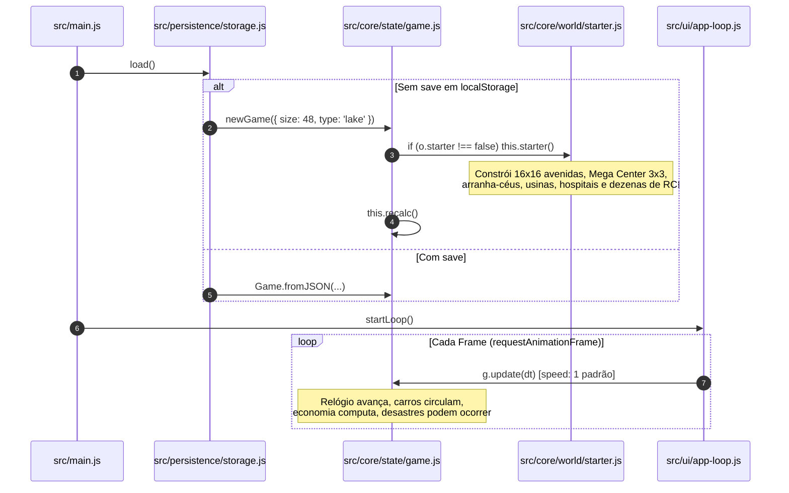

# 01 — Diagnóstico Técnico do Jogo Atual e Inconsistências

> **Status do Documento:** Planejamento Oficial — Fase de Diagnóstico Técnico  
> **Data:** 30/10/2026  
> **Arquivos Analisados:** Todos os módulos de `src/`, documentação em `docs/00`–`09`, monólito de referência `index.monolith.html`, `server.js` e `package.json`.  
> **Princípio de Auditoria:** Distinguir estritamente o que está implementado e verificado, o que é documentado como plano futuro, o que está inconsistente e o que é novo.

---

## 1. Inventário da Estrutura Atual do Código

O projeto foi migrado de um monólito em HTML único para uma arquitetura modular em ES Modules dividida em 6 camadas estritas:

```
gittown/
├── docs/                        # Base de documentação técnica 00 a 09
├── imgs/                        # 28 capturas de tela sequenciais de referência
├── src/
│   ├── api/                     # Fachada window.Delta (delta-api.js)
│   ├── core/
│   │   ├── entities/            # Building, Draft, Stubs
│   │   ├── math/                # Noise (qnoise, fbm, ridgedFbm), Util (hash2, clamp), Vector
│   │   ├── sim/                 # Clock, Economy, Events, Growth, Happiness-Demand, Network, Vehicles
│   │   ├── state/               # Game, Persistence
│   │   ├── tools/               # Inspect, Placement, Selection, Tools
│   │   └── world/               # Footprint, Starter, Terrain-gen, Terrain-queries
│   ├── html/                    # Templates parciais hud.html e modal.html
│   ├── persistence/             # Storage (localStorage, auto-save)
│   ├── render/
│   │   ├── buildings/           # Primitives, Palettes, Residential, Commercial, Industrial, Services, Skyscrapers, Registry
│   │   ├── raster/              # Caches, Pixel (fillPoly, erasePoly), Terrain-texture (terrTri, terrainTex)
│   │   ├── camera.js, effects.js, night-pass.js, object-pass.js, renderer.js, roads.js, selection-pass.js, terrain-pass.js
│   │   └── runtime/             # Console, Debug, Plugins, Runtime, Script-lifecycle
│   ├── styles/                  # Base, Components, Hud, Modal, Responsive, Tokens, Viewport
│   ├── ui/                      # App-loop, Build-menu, Config, Dom, Hud, Icons, Input, Modals
│   └── main.js                  # Ponto de entrada (Composition Root)
├── index.html                   # Shell HTML de carregamento
├── server.js                    # Servidor HTTP estático nativo em Node.js (porta 5173)
├── vite.config.js               # Configuração do Vite 5.4.0
└── package.json                 # Scripts: dev (vite), start (node server.js), build
```

---

## 2. Auditoria da Questão de Autenticação e Entrada

### 2.1. O que realmente existe no código atual
Foi realizada uma busca textual exaustiva por termos como `admin`, `login`, `auth`, `password` e `user` em todo o repositório:
- **Resultado:** **Zero linhas de código de autenticação**.
- O jogo é uma aplicação 100% *client-side*, servida estaticamente via Node (`server.js`) ou Vite (`vite.config.js`).
- O estado da partida é mantido exclusivamente no navegador via `localStorage` com a chave `delta_city_v4` ([`src/ui/config.js`](file:///c:/Users/Carlos/Documents/gittown/src/ui/config.js)).
- Não existe banco de dados centralizado, sessão de servidor, JWT, cookies de autenticação ou infraestrutura de contas.

### 2.2. Avaliação de Necessidade: O jogo precisa de login?
1. **Gênero e Natureza do Jogo:** O Delta City é um simulador urbano isométrico *single-player*, estilo *sandbox* e gerenciamento civil. Nenhum jogo desse gênero para navegador (ou mesmo TheoTown / SimCity em seus modos locais) exige login e senha para construir cidades no ambiente local.
2. **Fricção Injustificada:** Introduzir uma barreira de autenticação com formulário de usuário e senha em um jogo *single-player* local criaria fricção inútil para o jogador, além de exigir infraestrutura de backend desnecessária nesta fase.
3. **Credencial `admin/admin`:** O uso de credenciais fixas de demonstração (`admin/admin`) em ambiente de desenvolvimento é comum em painéis corporativos, mas não possui valor para um jogo de entretenimento.
4. **Recomendação Definitiva de Arquitetura:**
   - **Eliminar qualquer necessidade de login/senha para jogar.**
   - Substituir a ideia de autenticação por uma **Tela de Título / Menu Inicial** elegante que inclui a identificação local do jogador: **"Nome do Prefeito" (Mayor Profile)** salvo no `localStorage`.
   - Caso um modo de compartilhamento em nuvem ou ranking online venha a ser implementado no futuro, aí sim uma camada de conta federada opcional poderá ser plugada na camada de runtime, sem jamais bloquear a experiência *offline* local.

---

## 3. Diagnóstico do Início Prematuro da Simulação

### 3.1. A Cadeia de Execução Atual
Ao carregar a página `index.html`, a seguinte cadeia ocorre de forma síncrona e ininterrupta:



### 3.2. Problemas Identificados nessa Cadeia:
1. **Destruição do Terreno Virgem:** O método `starter()` em [`src/core/world/starter.js`](file:///c:/Users/Carlos/Documents/gittown/src/core/world/starter.js) terraplena forçadamente o centro do mapa com `this.flattenArea(c - 8, c - 8, 16, 16, 2)`, apagando a geografia natural gerada pelo algoritmo de ruído procedural antes mesmo que o jogador possa vê-la.
2. **Construção Automática de Monumentos Avançados:** O método insere o *Mega Center Delta* (3x3), *Torre Corporativa* (2x2), *Condomínio Imperial* (2x2) e serviços complexos que deveriam ser a recompensa máxima da fase *endgame* da cidade!
3. **Simulação Descontrolada no Primeiro Segundo:** O atributo `speed` inicial da classe `Game` é configurado como `1` ([`src/core/state/game.js#L25`](file:///c:/Users/Carlos/Documents/gittown/src/core/state/game.js#L25)). O laço principal em [`src/ui/app-loop.js#L76`](file:///c:/Users/Carlos/Documents/gittown/src/ui/app-loop.js#L76) começa a chamar `g.update(dt)` sem pausa, gastando orçamento com manutenções de prédios que o jogador sequer sabia que existiam.
4. **Sem Escolha de Parâmetros:** O jogador não pode escolher o tamanho da cidade, a semente procedural ou a dificuldade antes do mundo nascer.

---

## 4. Diagnóstico da Identidade Visual e Renderização

### 4.1. O Terreno "Plástico" e a Ausência de Pixel Art Genuíno
Ao examinar [`src/render/raster/terrain-texture.js`](file:///c:/Users/Carlos/Documents/gittown/src/render/raster/terrain-texture.js):
- A função `terrTri` interpola os atributos de vértice $[R, G, B, \text{rough}, w_x, w_y]$ através de cálculo contínuo de ponto flutuante scanline por scanline:
  $$\text{lerp}(L, R, s) = L + (R - L) \cdot s$$
- Em seguida, calcula uma modulação de textura via `bil`:
  $$m = 1 + \text{rough} \cdot (\text{bil}(w_x \cdot 0.4 + 7, w_y \cdot 0.4 + 3) - 0.5) \cdot 2$$
  onde `bil` usa uma curva Hermite suave $s_x = f_x^2(3 - 2f_x)$ para filtrar a textura `terrainTex`.
- **Efeito Visual Resultante:** As colinas e montanhas apresentam um sombreamento Gouraud contínuo, sem paleta de cores restrita ou granulação em pixels, gerando superfícies com aparência lisa de borracha ou plástico esbranquiçado.
- As capturas de referência em `imgs/` (especialmente [`Screenshot_20261030_155543_TheoTown.jpg`](file:///c:/Users/Carlos/Documents/gittown/imgs/Screenshot_20261030_155543_TheoTown.jpg) e [`Screenshot_20261030_155554_TheoTown.jpg`](file:///c:/Users/Carlos/Documents/gittown/imgs/Screenshot_20261030_155554_TheoTown.jpg)) mostram exatamente o oposto:
  - O terreno é composto por **texels discretos** de pixel art com paleta controlada em 4 a 6 tons de verde escuro terroso.
  - A orla costeira possui uma **faixa de areia amarelada pontilhada (dithered)** com degraus em pixel art sobre a água escura.
  - A água não é um gradiente azul puro, mas possui ondas estáticas ou em degraus pixelados.

### 4.2. Conflito Gráfico nos Edifícios
Em [`src/render/buildings/primitives.js`](file:///c:/Users/Carlos/Documents/gittown/src/render/buildings/primitives.js):
- A função `awning` (toldos comerciais, linhas 59–67) desenha toldos calculando `n = Math.max(2, Math.round((s1 - s0) * 12))` e preenchendo polígonos listrados alternados. Em níveis médios de zoom, essas listras ficam com 1 ou 2 subpixels de largura, gerando artefatos de aliasing (efeito moiré) e uma aparência vetorial estranha à estética de pixel art.
- Algumas primitivas usam `jit` (jitter de ruído pseudoaleatório por pixel em `fillPoly`), mas como o terreno não possui jitter correspondente, o edifício parece colado sobre uma fotografia desfocada.

---

## 5. Matriz de Auditoria de Funcionalidades

Para garantir que nenhuma decisão seja tomada com base em falsas premissas, a tabela a seguir separa as funcionalidades em quatro categorias estritas:

| Funcionalidade / Sistema | Estado Real Atual | Onde no Código | Observações Técnicas |
|---|---|---|---|
| **Geração de Relevo FBM 2 Fases** | Implementada e Verificada | `src/core/world/terrain-gen.js` | Funciona perfeitamente. Determinística para a mesma semente (`seed`, `N`, `type`). |
| **Grade de Vértices e Altimetria (N+1)** | Implementada e Verificada | `src/core/world/terrain-queries.js` | `cornerH`, `slopeMask`, `isFlat`, `isSlope` funcionam corretamente. |
| **Sistema Multi-Tile por Pivô** | Implementada e Verificada | `src/core/world/footprint.js` | Suporta 1x1, 2x2 e 3x3 com `pivot`, `bSize` e terraplenagem automática. |
| **Rede Elétrica e Hídrica (BFS)** | Implementada e Verificada | `src/core/sim/network.js` | Propagação 8-conectada funcional (`net`, `spread`). |
| **Simulação Econômica e Inflação** | Implementada e Verificada | `src/core/sim/economy.js` | Arrecadação mensal `tr, tc, ti`, despesas `up`, juros `interest` e falência funcionam. |
| **Persistência `localStorage` v5** | Implementada e Verificada | `src/core/state/persistence.js` | Serialização e desserialização SoA com migrador v4→v5 funcional. |
| **Câmera, Zoom e Projeção Isométrica** | Implementada e Verificada | `src/render/camera.js`, `src/ui/input.js` | Quantização de zoom em `ZL`, pan por mouse/touch e projeção `T(x,y)` funcionam. |
| **Cidade Inicial Automática (`starter`)** | Implementada e Problemática | `src/core/world/starter.js` | Constrói metrópole no boot roubando a agência do jogador. Deve ser desativada do fluxo padrão. |
| **Simulação Iniciando a 1x no Boot** | Implementada e Problemática | `src/ui/app-loop.js`, `src/core/state/game.js` | Roda imediatamente no frame 1 sem consentimento do jogador. Deve abrir em `speed: 0`. |
| **Renderizador Gouraud / Bicúbico** | Implementada e Problemática | `src/render/raster/terrain-texture.js` | Gera terreno plástico e liso, destoando do pixel art. Precisa ser quantizado e dithered. |
| **Autenticação / Login com Senha** | Inexistente (Incompatível) | N/A | Inexistente no código. Não deve ser implementada como login clássico; substituir por tela de título e perfil local. |
| **26 Mapas de Influência da API TheoTown** | Documentada, Não Verificada | `Delta City plano revisado...` | Apenas 6 mapas de calor simples estão ativos na UI (`HEATS` em `app-loop.js`). |
| **Transporte Público (Ônibus, Trens)** | Documentada, Inexistente | `Delta City plano revisado...` | Citado no plano TheoTown, mas não há código de linhas de ônibus ou trens em `src/core/sim/`. |
| **Serviço de Lixo e Corpos** | Documentada, Inexistente | `Delta City plano revisado...` | Documentado nas ideias de expansão, mas inexistente no runtime de `src/`. |
| **Progressão por Níveis de Cidade (*Ranks*)** | Inexistente (Nova Proposta) | Proposta neste plano | Não há travas de desbloqueio ou metas; todos os prédios estão abertos desde o dia 1. |
| **Tela de Título e Seletor de Novo Mundo** | Inexistente (Nova Proposta) | Proposta neste plano | Atualmente o jogo abre diretamente no canvas sem menu principal ou configuração de semente. |

---

## 6. Gargalos e Inconsistências Críticas a Corrigir

1. **Acoplamento do `newGame` com a Inicialização Automática:**
   Em [`src/persistence/storage.js`](file:///c:/Users/Carlos/Documents/gittown/src/persistence/storage.js#L29), a chamada `newGame({ size: 48, type: 'lake' })` é executada automaticamente caso não haja save. Isso impede a exibição de uma tela de boas-vindas com configuração de semente e opções de partida.
2. **Determinismo Quebrado no Laço de Simulação:**
   Conforme registrado em [`docs/00_INDEX_AND_GLOSSARY.md`](file:///c:/Users/Carlos/Documents/gittown/docs/00_INDEX_AND_GLOSSARY.md#L144), as funções `moveVehicles` e `spawnCars` em [`src/core/sim/vehicles.js`](file:///c:/Users/Carlos/Documents/gittown/src/core/sim/vehicles.js) consomem `g.rand()` a cada quadro gráfico desenhado. Como dispositivos diferentes rodam a 30, 60 ou 120 FPS, a semente interna `g.rs` avança em ritmos diferentes, fazendo com que duas máquinas com a mesma semente inicial divirjam rapidamente na simulação urbana.
3. **Falta de Feedback do Estado Pausado:**
   Atualmente a HUD possui o botão de pausa no grupo `#spd`, mas não há indicação clara na tela de que o jogo está esperando a ordem do jogador para iniciar a vida na cidade.
