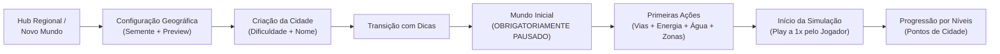

# 02 — Análise Sequencial das Imagens de Referência

> **Status do Documento:** Planejamento Oficial — Análise de Referências Visuais e Funcionais  
> **Data:** 30/10/2026  
> **Fonte:** 28 capturas de tela capturadas em sequência na pasta `imgs/` (`Screenshot_20261030_155317_TheoTown.jpg` a `Screenshot_20261030_155731_TheoTown.jpg`).  
> **Metodologia:** Reconstrução cronológica do fluxo real de usuário, análise de interface, extração da linguagem de pixel art e mapeamento de adaptações para o Delta City.

---

## 1. Inventário Sequencial Cronológico das 28 Capturas

A ordenação cronológica das capturas revela com clareza o ciclo de vida completo da experiência de um jogador, desde o carregamento do jogo e configuração de mundo até a gestão detalhada e inspeção de lotes:

| Nº | Arquivo (Timestamp) | Tela / Estado Representado | Componentes da Interface | Ação Provável do Jogador |
|---|---|---|---|---|
| **01** | `155317_TheoTown.jpg` | **Splash / Carregamento de Recursos** | Logo pixel art, versão `v1.12.91a`, contador de drafts (`28/303`), fundo com cidade noturna desfocada. | Aguarda o carregamento dos assets e drafts do jogo. |
| **02** | `155331_TheoTown.jpg` | **Carregamento de Cidade com Dica** | Nome da cidade ("Stuckenborstel"), barra de progresso, dica de gameplay (Bombeiros), "Prepare city". | Lê a dica contextual enquanto o mapa é preparado em memória. |
| **03** | `155340_TheoTown.jpg` | **Boas-Vindas / Rendimentos Offline** | Diálogo modal "Bem-vindo de volta!", resumo de 4 prédios concluídos e ganhos monetários (+112K T). | Coleta os rendimentos da sessão anterior para retomar o jogo. |
| **04** | `155357_TheoTown.jpg` | **Hub de Regiões / Seleção de Mundo** | Vista isométrica regional no espaço ("Theonia"), parcelas com cadeados, parcela ativa selecionada com card de resumo (Pop: 59, Modo: Fácil, Tempo: 1m51s), botões "+ Nova região", "Cidades individuais", bulldozer, repair e [Jogar]. | Escolhe qual parcela jogar ou decide criar uma nova região/mundo. |
| **05** | `155405_TheoTown.jpg` | **Modal "Nova Região" (Geração de Mundo)** | Campo de Semente (`402269668`) com botão de dado (aleatório), seletor de Tamanho, Layout (2x2 ou Círculo), toggles "Com árvores", "Decorações", "Terreno", "Biomas" e **Minimapa de prévia ao vivo**! Botão [Continuar]. | Configura a semente e os parâmetros geográficos visualizando o mapa procedural antes de confirmar. |
| **06** | `155430_TheoTown.jpg` | **Modal "Nova Cidade" (Configuração da Cidade)** | Campo de Nome ("Faeeco") com dado aleatório, 4 modos de jogo (Fácil, Médio, Difícil, Sandbox), descrição do modo, opção "Tráfego mão esquerda", botão [Começar]. | Define o nome da cidade, a dificuldade e confirma a criação do lote. |
| **07** | `155438_TheoTown.jpg` | **Transição: Carregando Cidade** | Barra de progresso "Carregando cidade", dica sobre rotação e navegação ("Gire o mapa usando o minimapa"). | Aguarda o carregamento do terreno e inicialização da cena. |
| **08** | `155543_TheoTown.jpg` | **Mundo Inicial Pronto (PAUSADO)** | Visão geral da cidade inicial. **Relógio pausado (`\|\|` amarelo ativo)**. HUD limpo: ferramentas à esquerda, pílula de status superior (Pop: 81, Felicidade: 57%-), mostrador circular de objetivo ("0 Habitação Isolada"), data, velocidade, finanças (+950 T/mês) e minimapa. | O jogador analisa o terreno e o vilarejo com a simulação pausada antes de tomar decisões. |
| **09** | `155554_TheoTown.jpg` | **Inspeção de Terreno e Escala de Pixel Art** | Zoom extremo sobre a floresta e o solo. Texels nítidos de árvores e dither de grama visíveis sem blur. | Observa a textura da vegetação e o alinhamento da grade de pixels em zoom máximo. |
| **10** | `155626_TheoTown.jpg` | **Inspeção de Mobilidade e Veículos** | Zoom máximo em estrada e carro vermelho. Faróis acesos projetando pixels claros no asfalto, faixa tracejada, guias e calçadas. | Observa o tráfego e os detalhes das vias urbanas. |
| **11** | `155632_TheoTown.jpg` | **Inspeção Arquitetônica Residencial** | Zoom máximo em casas e sobrados. Telhados com texturas em dither cerâmico, chaminés, recuos de janelas, calçadas de entrada, jardins e sombras direcionais consistentes. | Avalia a estética arquitetônica dos edifícios de baixa/média densidade. |
| **12** | `155638_TheoTown.jpg` | **Modal de Níveis e Metas da Cidade** | Barra de 13 abas de gestão. Aba aberta: "Níveis". Lista de marcos (Habitação Isolada 0, Aldeia 1, Vilarejo pequeno 2, Vilarejo 3...) com requisitos de Pontos de Cidade. | Consulta quais são os próximos objetivos para subir o rank da cidade. |
| **13** | `155643_TheoTown.jpg` | **Modal Gestão: Visão da Cidade** | Aba 1 ("Visão da cidade"): Nome da cidade (editável), Autor, Semente (com botão copiar), Modo de jogo, Pontos da cidade (455), atalho para estatísticas. | Confere os dados mestres e a semente do mundo atual. |
| **14** | `155645_TheoTown.jpg` | **Modal Gestão: Estatísticas Gráficas** | Aba 2 ("Estatísticas"): Gráfico temporal de habitantes por classe (Pobres, Classe média, Ricos) ao longo dos meses. | Analisa a curva de crescimento demográfico e social da cidade. |
| **15** | `155648_TheoTown.jpg` | **Modal Gestão: Níveis e Desbloqueios** | Aba 3 ("Níveis"): Repetição da visualização de progressão por pontos. | Avalia os requisitos para o próximo nível. |
| **16** | `155650_TheoTown.jpg` | **Modal Gestão: Demandas RCI por Riqueza** | Aba 4 ("Demandas"): Barras de demanda de Residencial, Comercial e Industrial divididas por 3 classes: Pobre (I), Médio (II) e Riquíssimo (III). | Identifica qual setor da economia necessita de novos zoneamentos. |
| **17** | `155653_TheoTown.jpg` | **Modal Gestão: Avaliação e Felicidade** | Aba 5 ("Avaliação"): Felicidade geral (57,7%-) e detalhamento percentual por setor (Saúde, Meio ambiente, Parques, Impostos, Esportes, Religião, Educação). | Descobre quais serviços estão deficientes e causando insatisfação. |
| **18** | `155657_TheoTown.jpg` | **Modal Gestão: Finanças e Impostos** | Aba 6 ("Finanças"): Saldo em caixa, botões de auxílio financeiro, arrecadação mensal discriminada por setor e classe social com controle de alíquota (7.0%). | Ajusta os impostos para equilibrar a arrecadação sem expulsar cidadãos. |
| **19** | `155659_TheoTown.jpg` | **Modal Gestão: Empréstimos Bancários** | Aba 7 ("Empréstimo"): Linhas de crédito bancário (10.0K T a pagar em 96 meses com custo mensal de 125 T). Lista de 0/5 empréstimos ativos. | Avalia a contratação de empréstimo para obras de infraestrutura urgentes. |
| **20** | `155701_TheoTown.jpg` | **Modal Gestão: Balanço de Energia** | Aba 8 ("Energia"): Número de redes elétricas (1), Produção (50 kW), Consumo (24 kW), Taxa de uso (48,0%), ferramenta de lupa para inspecionar fontes. | Verifica se há folga de geração elétrica antes de aprovar novas zonas. |
| **21** | `155704_TheoTown.jpg` | **Modal Gestão: Balanço de Água** | Aba 9 ("Água"): Redes de água (1), Produção (2.000 L/h), Consumo (206 L/h), Uso (10,3%), Esgoto (0,0%). | Confere a capacidade dos reservatórios e tubulações de água. |
| **22** | `155706_TheoTown.jpg` | **Modal Gestão: Educação** | Aba 10 ("Educação"): Escolas (0), Necessário (8), Atendido (0), Disponível (0) em Educação básica e Educação avançada. | Identifica o déficit de vagas escolares na cidade. |
| **23** | `155708_TheoTown.jpg` | **Modal Gestão: Saúde** | Aba 11 ("Saúde"): Prédios (0), Necessário (107), Atendido (0), Disponível (0). | Identifica a falta de postos de saúde para atender a população. |
| **24** | `155713_TheoTown.jpg` | **Modal Gestão: Acordos com Vizinhos** | Aba 12 ("Acordos com vizinhos"): Relações comerciais com cidades da mesma região para importação/exportação de serviços. | Consulta se há cidades vizinhas conectadas para negociar excedentes. |
| **25** | `155716_TheoTown.jpg` | **Modal Gestão: Desbloqueio de Transporte** | Aba 13 ("Transporte"): Lista de transportes avançados com seus requisitos de desbloqueio (Ônibus exige Vilarejo 3, Trens de passageiros exigem Município 6, Trem elevado exige Cidade pequena 9). | Planeja as próximas metas para liberar transportes de massa. |
| **26** | `155719_TheoTown.jpg` | **Modal Gestão: Infraestrutura de Aeroporto** | Aba 14 ("Aeroporto"): Alertas de dependências estruturais ("Sem torre: Você precisa construir uma torre para controlar seu aeroporto"). | Confere os requisitos técnicos antes de iniciar uma megaestrutura. |
| **27** | `155725_TheoTown.jpg` | **Inspetor de Lote: Prédio Residencial** | Cartão de inspeção: "Residencial T", Habitantes (7/7), Felicidade geral (58%), causas de baixa felicidade (Transporte, Religião, Educação), tempo de construção (51 dias), botão toggle "[Intocável]". | Inspeciona um lote habitacional individual e ativa proteção contra demolição automática. |
| **28** | `155731_TheoTown.jpg` | **Inspetor de Lote: Prédio Comercial** | Cartão de inspeção: "Comercial T", Trabalhadores (6/6), Felicidade geral (59%), fatores negativos (Transporte, Segurança, Bombeiros), tempo de construção (38 dias), botão toggle "[Intocável]". | Inspeciona o comércio local para diagnosticar a cobertura de segurança e bombeiros. |

---

## 2. Padrões Visuais e de Direção de Arte Extraídos

Ao analisar em detalhe as capturas `08`, `09`, `10`, `11`, `27` e `28`, identificamos os seguintes pilares fundamentais da arte que faltam ao Delta City atual:

### 2.1. Terreno em Pixel Art vs. Superfície Gouraud Lisa
- **A textura do solo:** O terreno não é uma cor pura com gradiente contínuo. Ele possui um padrão sutil de dither 2x2/4x4 com 4 a 6 variações tonais de verde oliva e verde floresta, criando a ilusão tátil de grama sem gerar ruído que atrapalhe a visão dos edifícios.
- **Transição de Costa:** A costa não corta bruscamente a terra para a água nem usa um degradê suave. Ela possui uma faixa de areia em pixels de 1 a 2 tiles de largura, com bordas recortadas que comunicam a praia de forma clara.
- **Falésias e Encostas:** Encostas íngremes revelam estratos rochosos em degraus com quinas nítidas e sombras nas faces opostas à luz, em vez de triângulos lisos esticados.

### 2.2. Iluminação Direcional e Sombras Consistentes
- A fonte de luz é única e estável (vinda do quadrante superior-esquerdo).
- Cada edifício possui três faces claramente diferenciadas:
  - **Face superior (Teto/Telhado):** Tom base iluminado (100%).
  - **Face esquerda:** Meio-tom com leve sombreamento (85%).
  - **Face direita:** Sombra nítida (60% a 70%).
- As sombras projetadas no chão são translúcidas, porém respeitam a grade de pixels (sem blur gaussiano).

### 2.3. Coerência Arquitetônica e Riqueza de Materiais
- Os edifícios residenciais utilizam telhados cerâmicos clássicos com cumeeiras e calhas dithered, paredes em tons pasteis aconchegantes (bege, terracota, ocre, azul colonial) e calçadas cinzas de concreto com guias brancas.
- As janelas possuem recuos escuros de 1 pixel e molduras claras de 1 pixel, conferindo profundidade sem necessidade de texturas vetoriais complexas.
- Edifícios comerciais possuem fachadas de vidro com reflexos diagonais clássicos de pixel art e estacionamentos com marcações de vagas e carros estacionados.

### 2.4. Escala e Densidade de Pixels (*Texel Consistency*)
- Ao aplicar zoom máximo (`155554` e `155626`), nota-se que cada texel das árvores, dos carros e do chão mantém exatamente a mesma proporção geométrica: **escala inteira por nearest-neighbor**. Não há partes do jogo com subpixels minúsculos convivendo com blocos gigantescos de baixa resolução.

---

## 3. Padrões de Interface e Experiência do Jogador

A análise das telas `04` a `08` e `12` a `26` revela um modelo de experiência do jogador extraordinariamente bem desenhado, que devemos adaptar:

### 3.1. Separação Clara entre Criação do Mundo e Início do Jogo
- O jogador primeiro escolhe ou gera a semente procedural e visualiza o resultado em uma prévia gráfica antes de aceitá-la (`155405`).
- Em seguida, escolhe a dificuldade (Fácil, Médio, Difícil, Sandbox), que determina os fundos iniciais e os desafios econômicos (`155430`).
- O mundo abre com a **simulação estritamente em pausa** (`155543`). O jogador tem tempo ilimitado para examinar o terreno, identificar a melhor área plana próxima à água e planejar seus primeiros quarteirões sem estresse de tempo ou perda de recursos.

### 3.2. Progressão Estruturada por Níveis de Cidade (*City Ranks*)
- Em vez de tutoriais que bloqueiam cliques, o jogo adota um sistema de **Marcos de Evolução** (`155638` e `155716`).
- A cidade inicia no nível `0` ("Habitação Isolada") e avança conforme acumula Pontos de Cidade (decorrentes de população, felicidade e infraestrutura).
- Cada novo nível destrava uma nova camada de complexidade urbana (delegacias, bombeiros, hospitais, ônibus, trens, zonas densas), garantindo que o jogador nunca seja sobrecarregado no início.

### 3.3. Painéis de Informação e Diagnóstico Temáticos
- As 13 abas de gestão (`155643` a `155719`) concentram em um único local tudo o que o prefeito precisa saber, com gráficos simples e métricas de demanda direta por classe social (Pobre I, Médio II, Rico III).
- Cada indicador de felicidade aponta claramente qual serviço está faltando (ex.: 50% em Religião, 49% em Transporte), dando ao jogador uma rota de ação clara.

---

## 4. O que Adaptar para o Delta City vs. O que Descartar

| Elemento das Referências | Adotar no Delta City? | Justificativa Técnica / Design |
|---|---|---|
| **Tela de Título e Novo Mundo com Semente + Preview** | **SIM** | Essencial para permitir replayabilidade determinística e controle pelo jogador. |
| **Mundo inicial abrindo em estado estritamente PAUSADO** | **SIM** | Resolve a perda de agência diagnosticada no item 4.2 do documento principal. |
| **Terreno com micro-dither e paleta de pixel art** | **SIM** | Elimina a aparência plástica e unifica o estilo visual com os prédios. |
| **Costa com faixa de praia e falésias estratificadas** | **SIM** | Aumenta o valor estético e a legibilidade da topografia. |
| **Progressão por Níveis de Cidade (*Milestones*)** | **SIM** | Fornece objetivos claros e sensação contínua de conquista. |
| **Inspetor com botão "[Intocável]"** | **SIM** | Permite ao jogador preservar construções históricas contra upgrades automáticos. |
| **Abas de Gestão Urbana Temáticas** | **SIM** | Unifica as 4 abas rudimentares atuais em um painel completo e informativo. |
| **Moeda secundária de Diamantes / Gemas** | **NÃO** | Delta City é um jogo livre de microtransações; introduzir gemas geraria confusão estética e mecânica. |
| **Anúncios para dobrar ganhos offline** | **NÃO** | Mecânica de monetização predatória inadequada para o projeto. |
| **Grade de Regiões Multi-cidades no primeiro momento** | **ADIAR** | Focar 100% na experiência perfeita da cidade individual antes de construir a malha interurbana. |
