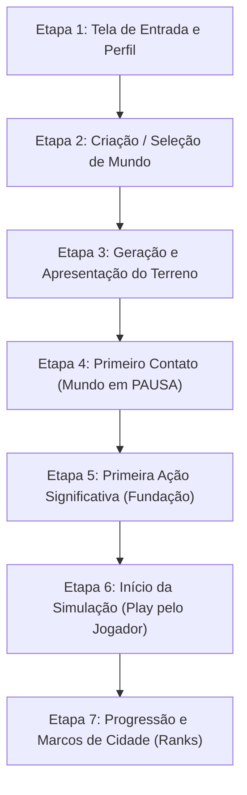
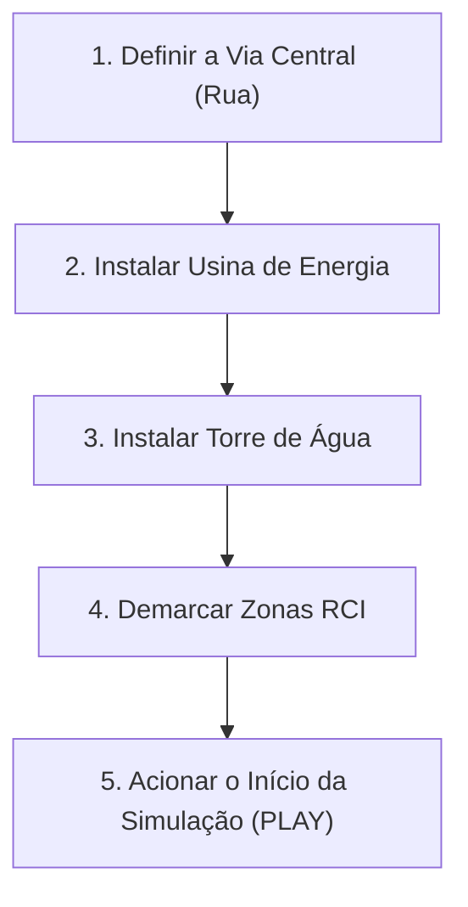

# 03 — Jornada do Jogador: Da Abertura à Progressão Urbana

> **Status do Documento:** Planejamento Oficial — Design da Experiência do Usuário (UX/Gameplay)  
> **Data:** 30/10/2026  
> **Objetivo:** Projetar a sequência lógica completa de interação do jogador, eliminando a automação prematura e garantindo agência, clareza de metas e sensação constante de recompensa.

---

## 1. Visão Geral da Jornada do Jogador

A jornada do jogador no Delta City é estruturada em **7 etapas consecutivas**, desenhadas para transformar a experiência atual (onde o jogo começa jogando sozinho) em um processo deliberado de colonização, planejamento urbano e expansão metropolitana:

---

## 2. Detalhamento Passo a Passo das Etapas

### Etapa 1 — Tela de Entrada, Autenticação e Seleção de Cidade
O jogador acessa o endereço da aplicação (`http://localhost:5173`). Em vez de ser jogado imediatamente no meio de uma simulação ativa:
1. **Apresentação e Conexão:** Uma **Tela de Entrada Online** é exibida sobre um fundo renderizado em baixa luminosidade de uma cidade clássica em pixel art.
2. **Autenticação e Sessão Remota:** 
   - Painel de Login e Identificação do Prefeito:
     - Campos: *Usuário* e *Senha* (com botão de criar conta rápida).
     - **Ambiente Local / Demonstração:** Suporta a credencial rápida `admin/admin` com preenchimento em 1 clique para agilidade em testes.
     - Validação via backend (`POST /api/auth/login`), estabelecendo token de sessão persistido em `localStorage`.
     - Tratamento amigável de credenciais com toast de erro sem recarregar a página.
3. **Menu Principal Pós-Autenticação:**
   - Exibe a saudação: *"Bem-vindo, Prefeito [Nome]"* com botão de alternar usuário.
   - `[NOVO MUNDO]`: Abre a interface de criação de mundo com semente (Etapa 2).
   - `[CONTINUAR CIDADE REMOTA]`: Lista as cidades salvas do jogador na nuvem (com miniatura, população, saldo e data).
   - `[CONFIGURAÇÕES]`: Opções de áudio, gráficos pixel art e confirmação de demolição.

---

### Etapa 2 — Criação ou Seleção de Mundo
Ao clicar em `[NOVO MUNDO]`, abre-se o modal de configuração de mundo, inspirado na tela de referência `155405`:

1. **Parâmetros Geográficos:**
   - **Nome da Cidade:** Campo de texto livre com botão de dado para gerar nomes aleatórios pitorescos (ex.: *Vila Serena*, *Porto Real*, *Vale Verde*).
   - **Semente Procedural (Seed):** 
     - Campo numérico de 32 bits editável.
     - Botão `[🎲]` que gera uma semente aleatória baseada em `(Date.now() & 0xffffff) >>> 0`.
     - Exibição clara do valor para facilitar compartilhamento.
     - **Garantia de Determinismo:** A mesma semente combinada com o mesmo tamanho e tipo de relevo produzirá **exatamente a mesma geografia** (elevação, bacias e rios).
   - **Tamanho do Território ($N$):**
     - `Pequeno (32x32)`: Partida rápida e focada em aparelhos modestos.
     - `Médio (48x48)`: Equilíbrio ideal entre espaço e desempenho (Padrão).
     - `Grande (64x64)`: Para cidades com distritos expandidos.
     - `Metrópole (96x96)`: Para prefeitos avançados em desktops.
   - **Topografia / Bioma:**
     - `Continente`: Relevo amplo com pouca água superficial.
     - `Lago`: Bacia hidrográfica central ideal para iniciantes (Padrão).
     - `Rio`: Rio sinuoso que corta o mapa exigindo pontes.
     - `Ilha`: Área costeira com espaço de terra limitado.
2. **Modo de Jogo / Dificuldade (Inspirado na referência `155430`):**
   - **Fácil:** Saldo inicial de $\$50.000$, inflação reduzida ($2\%$), cidadãos tolerantes a impostos.
   - **Médio (Padrão):** Saldo inicial de $\$28.000$, inflação normal ($4\%$), economia equilibrada.
   - **Difícil:** Saldo inicial de $\$12.000$, inflação alta ($6\%$), juros de dívida elevados ($12\%$).
   - **Sandbox:** Saldo infinito ($\$999.999$), construções gratuitas e obras instantâneas.
3. **Opção de Ponto de Partida:**
   - **`[x] Terreno Virgem (Padrão Oficial)`**: O mapa nasce 100% natural, sem construções. O jogador constrói tudo do zero.
   - **`[ ] Cidade Pioneira (Cenário Demo)`**: Aciona opcionalmente o script `starter.js` para quem deseja apenas explorar ou depurar edifícios complexos.
4. **Prévia Procedural em Miniatura (Minimapa ao Vivo):**
   - Ao alterar a semente, o tamanho ou a topografia, uma prévia em miniatura do relevo é renderizada instantaneamente no canto do modal, permitindo ao jogador escolher o relevo perfeito antes de confirmar.
5. **Botão de Confirmação:** `[FUNDAR CIDADE]` com ícone de bandeira.

---

### Etapa 3 — Geração e Apresentação do Mundo
Ao confirmar a fundação:
1. **Transição Suave:** A interface exibe uma barra de progresso breve:
   - *"Modelando relevo continental..."* (Fase 0 de terreno)
   - *"Plantando florestas e delineando costas..."* (Fase 1 de biomas)
   - *"Alocando registros municipais..."*
   - Uma dica de jogabilidade útil é apresentada no rodapé (ex.: *"Dica: Zonas residenciais próximas a indústrias sofrem com poluição e perdem valor"*).
2. **Posicionamento da Câmera:**
   - A câmera enquadra suavemente o centro da maior planície edificável próxima à água, com nível de zoom médio (`hw = 28`) e iluminação da manhã (`tod = 0.32` / 07:40).
3. **Estado Inicial Obrigatório:**
   - **A SIMULAÇÃO INICIA ESTRITAMENTE EM PAUSA (`speed: 0`)**.
   - O botão `||` da HUD pisca em dourado sutilmente, comunicando que o tempo está parado.
   - O relógio não avança, nenhum fundo é debitado e nenhum habitante surge sem infraestrutura.

---

### Etapa 4 — Primeiro Contato com o Mundo
O mundo está gerado e visível. O jogador tem todo o tempo do mundo para se situar:
1. **HUD Limpa e Contextual:**
   - Topo: Nome da cidade, População: `0`, Felicidade: `100%` (neutra), Nível: `0 (Acampamento Pioneiro)`.
   - Canto inferior esquerdo: Data `01/01/2026`, botão `||` pausado em destaque, controles de velocidade `>`, `>>`, `>>>`.
   - Canto inferior direito: Saldo em caixa formatado (ex.: `+$28.0K`), saldo líquido mensal `$0`.
   - Canto superior direito: Mostrador de meta urbana semicircular apontando o primeiro objetivo: *"Primeiros Moradores (0/50)"*.
2. **Mensagem de Orientação Inicial (Banner Não-Bloqueante / Toast):**
   - Um balão amigável no topo informa:  
     > *"Bem-vindo, Prefeito! Este território está pronto para ser colonizado. Construa uma usina de energia, uma torre de água e conecte as primeiras ruas e zonas para fundar a cidade."*
3. **Ferramentas Iniciais em Destaque:**
   - As ferramentas do primeiro escalão (`Vias`, `Energia`, `Água`, `Zonas`) ficam com ícones acesos na barra lateral.
   - Megaestruturas e serviços complexos aparecem sinalizados com ícone de cadeado de nível de cidade.

---

### Etapa 5 — Primeira Ação Significativa do Jogador
Para transformar o terreno virgem em uma comunidade viva, o jogador deve executar o ciclo clássico de fundação:

#### As 4 Decisões Iniciais:
1. **Acesso Viário:**
   - *O que fazer:* Selecionar a ferramenta `Rua` e traçar a primeira via de 10 a 15 tiles na área plana.
   - *Por que:* Edifícios exigem acesso viário para se desenvolverem e para que carros possam transitar.
   - *Custo:* $\$10$ por tile.
2. **Abastecimento Elétrico:**
   - *O que fazer:* Posicionar uma `Usina solar` ($\$1.500$) ou `Usina a carvão` ($\$3.000$) junto à via.
   - *Por que:* Sem eletricidade, os lotes residenciais permanecem vazios ou são rapidamente abandonados.
3. **Abastecimento Hídrico:**
   - *O que fazer:* Posicionar uma `Torre de água` ($\$1.200$) e estender tubulações sob a via.
   - *Por que:* A água garante saúde e atratividade para a chegada de famílias.
4. **Zoneamento Pioneiro:**
   - *O que fazer:* Demarcar uma área de Zona Residencial (verde) e uma pequena Zona Comercial (azul) ou Industrial (amarela) a uma distância prudente.
   - *Resultado Visual:* O solo ganha piquetes delimitadores e grama demarcada em pixel art.

---

### Etapa 6 — Início da Simulação pelo Jogador
Com a infraestrutura mínima posicionada:
1. **Convite ao Início:** O botão `Play` (`>`) na HUD pulsa com uma borda verde luminosa e a mensagem informa:  
   > *"Infraestrutura pronta! Pressione ▶ para iniciar a simulação e receber os primeiros habitantes."*
2. **Ação do Jogador:** O jogador clica no botão `>` (velocidade 1x).
3. **Efeitos Visuais e Sonoros de Início:**
   - O relógio passa a avançar suavemente (`01/01/2026 08:00...`).
   - Carros civis pioneiros surgem nas vias conectadas.
   - Canteiros de obras com tapumes e andaimes em pixel art nascem nos lotes zoneados.
   - Partículas de poeira (*puffs*) sobem enquanto as primeiras casas residenciais de nível 1 são concluídas.
   - O contador de população sobe de `0` para `8`, `16`, `24`...
   - O mostrador de caixa exibe os primeiros impostos sendo arrecadados!

---

### Etapa 7 — Progressão e Próximos Objetivos (Sistema de Ranks)

À medida que a cidade se consolida, a progressão é orientada pela **Árvore de Níveis Municipais (City Ranks)**, inspirada diretamente na referência `155638`:

| Nível de Cidade | Nome Oficial | Requisito Populacional | Desbloqueios de Infraestrutura | Novos Desafios |
|---|---|---|---|---|
| **Nível 0** | **Habitação Isolada** | 0 hab | Rua básica, Fio elétrico, Tubulação, Zonas RCI 1x1, Usina solar, Torre d'água, Parques simples. | Fundação básica e sobrevivência fiscal. |
| **Nível 1** | **Aldeia Pioneira** | 100 hab | Delegacia de Polícia, Corpo de Bombeiros, Usina a carvão, Ferramenta de Plantar Árvores. | Primeiros riscos de incêndio florestal e pequenos furtos. |
| **Nível 2** | **Vilarejo** | 300 hab | Posto de Saúde / Hospital, Escola Municipal, Empréstimos Bancários de curto prazo. | Demanda por educação básica e saúde para classe média. |
| **Nível 3** | **Vila Próspera** | 800 hab | Paradas e Linhas de Ônibus, Edifícios RCI Nível 2 (Densidade Média), Parques com Quadras. | Tráfego viário, poluição industrial localizada. |
| **Nível 4** | **Cidade Pequena** | 2.000 hab | Trem de Passageiros, Zonas de Alta Densidade (Nível 3), Delegacia Central, Linhas de Crédito Expandidas. | Coalescência de prédios altos, engarrafamentos, crimes organizados. |
| **Nível 5** | **Cidade Média** | 5.000 hab | Arranha-Céus Comerciais e Residenciais 2x2 (*Condomínio Imperial*, *Torre Corp*), Hospital Central. | Fuga de capital se impostos > 18%, greves de servidores públicos. |
| **Nível 6** | **Metrópole Regional** | 10.000+ hab | *Mega Center Delta (3x3)*, *Torre Panorama (Landmark)*, Aeroporto Internacional, Acordos Regionais. | Gestão macroeconômica, controle de inflação e grandes crises. |

#### Feedback de Evolução:
- A cada nível atingido, um **Efeito de Celebração** ocorre na tela: banner festivo com fanfarra visual de pixel art, concessão de bônus financeiro municipal e notificação de todos os novos prédios destravados.
- O jogador sempre sabe **o que fazer a seguir**, pois a HUD apresenta em tempo real o progresso para o próximo rank.
