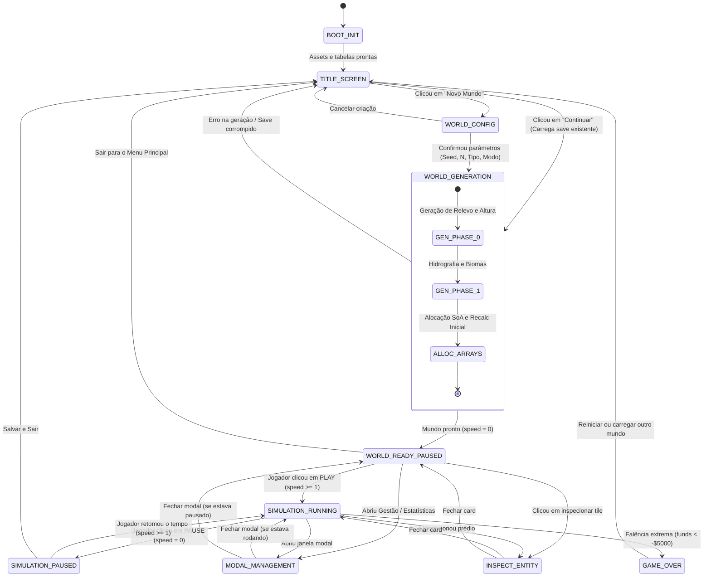

# 04 — Máquina de Estados da Experiência e da Simulação

> **Status do Documento:** Planejamento Oficial — Engenharia de Estados e Transições  
> **Data:** 30/10/2026  
> **Objetivo:** Definir com precisão matemática a máquina de estados finitos (FSM) da aplicação, desacoplando o carregamento da interface, a geração procedural do terreno e o ciclo de vida da simulação urbana.

---

## 1. Diagrama Geral da Máquina de Estados

---

## 2. Especificação Formal dos Estados

### 2.1. `BOOT_INIT` (Inicialização do Motor)
- **Objetivo:** Carregar módulos ES, registrar tabelas globais (`window.Delta`), pré-calcular tabelas de fontes, LUTs e inicializar o contexto Canvas.
- **Condições de Entrada:** Abertura do documento `index.html`.
- **Dados Necessários:** Scripts importados de `src/main.js`.
- **Ações Permitidas:** Inicialização de buffers, medição do viewport (`ResizeObserver`), leitura de configurações gerais em `localStorage` (chave `delta_city_cfg`).
- **Eventos de Saída:** Disparo de `BOOT_COMPLETE`.
- **Próximo Estado:** `TITLE_SCREEN`.
- **Comportamento ao Recarregar (F5):** Reexecuta a checagem limpa em milissegundos.

---

### 2.2. `TITLE_SCREEN` (Menu Principal)
- **Objetivo:** Servir de portal de entrada amigável, permitindo ao jogador escolher se cria uma nova cidade, retoma o jogo salvo ou ajusta opções.
- **Condições de Entrada:** Conclusão de `BOOT_INIT` ou comando "Sair para o Menu".
- **Dados Necessários:** Leitura de metadados do save ativo (`KEY = 'delta_city_v4'`) e nome do prefeito (`mayorName`).
- **Ações Permitidas:**
  - Clicar em `[NOVO MUNDO]` $\to$ transição para `WORLD_CONFIG`.
  - Clicar em `[CONTINUAR]` (se houver save) $\to$ transição para `WORLD_GENERATION`.
  - Alterar nome do Prefeito no campo de texto.
  - Clicar em `[CONFIGURAÇÕES]` $\to$ abrir diálogo de áudio/gráficos.
- **Eventos de Saída:** `UI_NEW_WORLD`, `UI_CONTINUE_GAME`.
- **Próximos Estados:** `WORLD_CONFIG`, `WORLD_GENERATION`.

---

### 2.3. `WORLD_CONFIG` (Configuração de Novo Mundo)
- **Objetivo:** Coletar os parâmetros de criação do mundo antes de alocar memória pesada.
- **Condições de Entrada:** Clique em `[NOVO MUNDO]` na `TITLE_SCREEN`.
- **Dados Necessários:** Semente gerada aleatoriamente ou inserida manualmente, tamanho padrão `48`, tipo `lake`, modo de dificuldade `medium`.
- **Ações Permitidas:**
  - Editar valor da semente numérica.
  - Clicar no botão `[🎲]` para gerar nova semente aleatória.
  - Selecionar tamanho ($32, 48, 64, 96$).
  - Selecionar topografia (`continent`, `lake`, `river`, `island`).
  - Selecionar modo de jogo (`easy`, `medium`, `hard`, `sandbox`).
  - Marcar/Desmarcar "Terreno Virgem" vs "Cidade Pioneira".
  - Visualizar a prévia procedural no minimapa.
  - Clicar em `[CANCELAR]` $\to$ retorna para `TITLE_SCREEN`.
  - Clicar em `[FUNDAR CIDADE]` $\to$ inicia geração.
- **Eventos de Saída:** `CONFIRM_WORLD_CREATION`, `CANCEL_WORLD_CREATION`.
- **Próximos Estados:** `WORLD_GENERATION`, `TITLE_SCREEN`.

---

### 2.4. `WORLD_GENERATION` (Geração Procedural e Alocação)
- **Objetivo:** Construir o terreno, calcular altimetria por cantos, classificar biomas e alocar os arrays SoA sem travar a thread de interface.
- **Condições de Entrada:** Disparo de `CONFIRM_WORLD_CREATION` ou carregamento de save existente.
- **Processamento Interno:**
  1. Instanciação `g = new Game({ seed, size, type, difficulty, starter: isStarter })`.
  2. Execução da Fase 0 (Altimetria `elevF` e `cornerH` via FBM e Domain Warping).
  3. Execução da Fase 1 (Umidade e Biomas: Água, Planície, Floresta, Colina).
  4. Cálculo de malha inicial (`g.recalc()`).
  5. Configuração estrita de velocidade: **`g.speed = 0`**.
- **Eventos de Saída:** `GENERATION_SUCCESS`, `GENERATION_ERROR`.
- **Próximos Estados:** `WORLD_READY_PAUSED` (em sucesso), `TITLE_SCREEN` (em erro com toast de alerta).

---

### 2.5. `WORLD_READY_PAUSED` (Mundo Apresentado em Pausa)
- **Objetivo:** Permitir ao jogador contemplar o mapa, navegar pela câmera, estudar o relevo e realizar os primeiros traçados de vias e zoneamento sem que o tempo corra.
- **Condições de Entrada:** Conclusão de `WORLD_GENERATION`.
- **Invariante Crítica:** **`g.speed === 0`**. Nenhuma rotina de envelhecimento de lotes, cobrança de manutenção, propagação de incêndio ou movimentação de veículos pode rodar.
- **Ações Permitidas:**
  - Mover câmera (`panBy`), alterar zoom (`hwF`).
  - Selecionar e posicionar vias, tubulações, fios, usinas e zonas.
  - Abrir e fechar janelas modais de informação.
  - Clicar no botão `Play` (`>`) $\to$ transição para `SIMULATION_RUNNING`.
- **Eventos de Saída:** `PLAYER_START_SIMULATION`, `OPEN_MODAL`, `OPEN_INSPECT`.
- **Próximos Estados:** `SIMULATION_RUNNING`, `MODAL_MANAGEMENT`, `INSPECT_ENTITY`.

---

### 2.6. `SIMULATION_RUNNING` (Simulação Urbana Ativa)
- **Objetivo:** Executar o ciclo de vida da cidade viva (economia, empregos, migração, crescimento de prédios, tráfego e serviços).
- **Condições de Entrada:** Jogador acionou velocidade $1\times, 2\times, 4\times$ ou $8\times$.
- **Processamento em Cada Quadro (`app-loop.js`):**
  - Avanço de tempo: `tod` (ciclo dia/noite), acumulador de dias `acc += dt * SPEEDS[g.speed]`.
  - Disparo de `dayTick()` a cada $5.000\text{ ms}$ de tempo simulado.
  - Disparo de `monthTick()` a cada 30 dias simulados (fechamento de orçamento).
  - Atualização de veículos e pedestres.
- **Ações Permitidas:** Todas as ações de construção, demolição, ajuste de impostos e inspeção.
- **Eventos de Saída:** `PLAYER_PAUSE`, `BANKRUPTCY_TRIGGERED`.
- **Próximos Estados:** `SIMULATION_PAUSED`, `GAME_OVER`.

---

### 2.7. `SIMULATION_PAUSED` (Pausa Manual do Jogador)
- **Objetivo:** Oferecer uma pausa tática durante a partida para planejamento urbano complexo, reforma viária ou reestruturação de serviços.
- **Condições de Entrada:** Jogador clicou no botão `||` ou pressionou a tecla `P`.
- **Comportamento:** O relógio para, a HUD exibe `PAUSADO`, mas a câmera e as ferramentas de construção continuam plenamente ativas.
- **Próximos Estados:** `SIMULATION_RUNNING`, `TITLE_SCREEN`.

---

### 2.8. `MODAL_MANAGEMENT` (Painel de Gestão Urbana)
- **Objetivo:** Exibir dados analíticos aprofundados sobre a cidade sem poluir o canvas principal.
- **Condições de Entrada:** Clique em qualquer indicador da HUD ou atalho de teclado (`B` para orçamento, etc.).
- **Comportamento da Simulação:** A simulação pode continuar rodando em segundo plano se o jogador desejar, ou pausar automaticamente dependendo da preferência configurada em `cfg.pauseOnModal`.
- **Próximos Estados:** Retorno ao estado de simulação anterior (`SIMULATION_RUNNING` ou `WORLD_READY_PAUSED`).

---

### 2.9. `GAME_OVER` (Falência Municipal)
- **Objetivo:** Tratar o estado terminal em que as dívidas da cidade ultrapassam o limite seguro ($\text{funds} < -\$5.000$ no fechamento do mês).
- **Condições de Entrada:** Validação em `monthTick()` ([`src/core/sim/economy.js#L715`](file:///c:/Users/Carlos/Documents/gittown/src/core/sim/economy.js#L715)).
- **Ações Oferecidas ao Jogador:**
  - `[PEDIR RESGATE FINANCEIRO]`: Aplica um empréstimo emergencial de socorro com juros elevados.
  - `[REINICIAR CIDADE]`: Apaga o progresso e recria o mundo a partir da mesma semente.
  - `[MENU PRINCIPAL]`: Retorna para `TITLE_SCREEN`.

---

## 3. Matriz de Transições e Prevenção de Inconsistências

| Estado Atual | Evento / Gatilho | Próximo Estado | Guarda / Validação | Efeito Colateral Garantido |
|---|---|---|---|---|
| `BOOT_INIT` | Conclusão do boot | `TITLE_SCREEN` | DOM pronto | Renderiza menu principal limpo |
| `TITLE_SCREEN` | Clicar em "Novo Mundo" | `WORLD_CONFIG` | Nenhuma | Sorteia semente padrão e zera campos |
| `TITLE_SCREEN` | Clicar em "Continuar" | `WORLD_GENERATION` | `saveExists === true` | Carrega dados brutos do JSON |
| `WORLD_CONFIG` | Clicar em "Fundar" | `WORLD_GENERATION` | Semente válida | Dispara transição com barra de progresso |
| `WORLD_GENERATION` | Geração finalizada | `WORLD_READY_PAUSED` | `g !== null` | **Força `g.speed = 0`**, centraliza câmera |
| `WORLD_READY_PAUSED` | Clicar em Play (`>`) | `SIMULATION_RUNNING` | Nenhuma | Define `g.speed = 1`, inicia fluxo do tempo |
| `SIMULATION_RUNNING` | Clicar em Pause (`\|\|`) | `SIMULATION_PAUSED` | Nenhuma | Define `g.speed = 0`, acende botão dourado |
| `SIMULATION_RUNNING` | Saldo $< -\$5.000$ | `GAME_OVER` | `dayTick` mensal | Congela simulação e exibe aviso de falência |

---

## 4. Tratamento de Erros, Recarregamento (F5) e Persistência

1. **Recarregamento da Página (F5 / Fechar Aba):**
   - O auto-save existente em [`src/persistence/storage.js`](file:///c:/Users/Carlos/Documents/gittown/src/persistence/storage.js#L47) salva o estado a cada 15 segundos e no evento `pagehide`.
   - Ao recarregar a página, se houver um save válido, o jogo **não entrará direto rodando**. A `TITLE_SCREEN` será apresentada com o botão `[CONTINUAR: NomeDaCidade]` em destaque.
   - Ao clicar em `[CONTINUAR]`, o mundo carrega exatamente na data e estado em que estava, mantendo a velocidade gravada no save ou abrindo em pausa caso configurado.
2. **Tratamento de Save Corrompido:**
   - Se o JSON do `localStorage` falhar na desserialização (`JSON.parse` ou `fromJSON`), o sistema captura o erro via `try...catch`, não trava a tela, exibe um toast informando *"Save corrompido ou incompatível"* e permanece de forma estável na `TITLE_SCREEN`.
