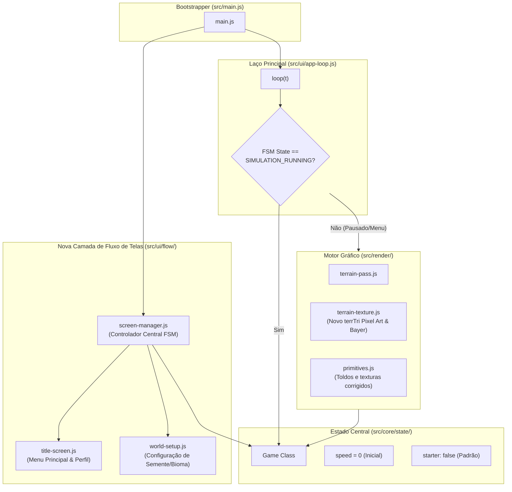

# 06 — Arquitetura Técnica, Componentes e Desacoplamento

> **Status do Documento:** Planejamento Oficial — Arquitetura de Software e Engenharia de Sistemas  
> **Data:** 30/10/2026  
> **Objetivo:** Mapear as alterações arquiteturais necessárias para suportar a nova máquina de estados, o fluxo inicial desvinculado, o novo pipeline de pixel art e o sistema de progressão, preservando a integridade modular de `src/` e evitando regressões.

---

## 1. Princípio Arquitetural: Evolução Incremental sem Reescrita

O Delta City já conta com uma base modular sólida dividida em 6 camadas estritas (Core, Render, API Facade, Runtime, UI/Persistence e Bootstrapper), conforme documentado em [`docs/01_ARCHITECTURE_AND_FLOW.md`](file:///c:/Users/Carlos/Documents/gittown/docs/01_ARCHITECTURE_AND_FLOW.md).

Portanto, **rejeita-se qualquer proposta de reescrita total**. Todas as mudanças propostas serão implementadas como **extensões cirúrgicas e desacoplamentos pontuais** dentro dos módulos existentes, mantendo as seguintes garantias:
1. A camada pura de kernel ([`src/core/*`](file:///c:/Users/Carlos/Documents/gittown/src/core/)) continua livre de dependências de DOM e renderização.
2. A camada de renderização ([`src/render/*`](file:///c:/Users/Carlos/Documents/gittown/src/render/)) continua acessando o estado de `Game` apenas como somente-leitura.
3. A fachada global `window.Delta` ([`src/api/delta-api.js`](file:///c:/Users/Carlos/Documents/gittown/src/api/delta-api.js)) permanece 100% retrocompatível com plugins existentes.
4. O formato de save persistente no schema v5 ([`src/core/state/persistence.js`](file:///c:/Users/Carlos/Documents/gittown/src/core/state/persistence.js)) é mantido, adicionando apenas campos retrocompatíveis opcionais (`mayorName`, `cityRank`, `gameMode`).

---

## 2. Diagrama de Arquitetura Alvo e Componentes Afetados



---

## 3. Mapeamento Detalhado das Mudanças por Módulo

### 3.1. Ponto de Entrada: `src/main.js`
- **Problema Atual:** Executa `load()`, `newGame()` e `startLoop()` em sequência automática no primeiro instante de execução.
- **Mudança Arquitetural:**
  - `src/main.js` agora inicializa o subsistema de DOM e chama `ScreenManager.init()`.
  - Se houver um save anterior válido, `ScreenManager` configura a `TITLE_SCREEN` com o botão `[CONTINUAR]` em evidência.
  - Se for a primeira execução, `ScreenManager` apresenta a `TITLE_SCREEN` convidando à criação de um `[NOVO MUNDO]`.
  - O `startLoop()` passa a rodar continuamente o renderizador da cena (ou fundo), mas **a simulação só recebe `g.update(dt)` quando o estado for `SIMULATION_RUNNING`**.

---

### 3.2. Gerenciador de Telas: `src/ui/flow/` (Novo Submódulo Limpo)
Criação de três componentes leves focados exclusivamente em gerenciar a experiência do jogador:
1. **`screen-manager.js`:** 
   - Mantém a variável de estado da FSM (`currentState`: `TITLE`, `CONFIG`, `WORLD_PAUSED`, `SIM_RUNNING`, etc.).
   - Dispara eventos de transição e troca as camadas visíveis do DOM (`#title-screen`, `#world-setup-modal`, `#hud-container`).
2. **`title-screen.js`:**
   - Controla os elementos do Menu Inicial: logo pixel art, versão do jogo, input do nome do prefeito, botão "Novo Mundo", botão "Continuar" e atalho de configurações.
3. **`world-setup.js`:**
   - Gerencia os inputs do diálogo de criação de mundo: semente, botão de dado aleatório, tamanho do mapa, bioma, dificuldade e o checkbox opcional "Terreno Virgem" vs "Cidade Pioneira".
   - Conecta a alteração desses inputs a um canvas miniatura de prévia instantânea.

---

### 3.3. Núcleo de Estado: `src/core/state/game.js` e `src/core/world/starter.js`
- **Problema Atual:** O construtor de `Game` chama `starter()` incondicionalmente quando `o.starter !== false`, e define `speed: 1`.
- **Mudança Arquitetural:**
  - Alteração na assinatura padrão de `new Game(o)`:
    ```js
    // Padrão oficial: starter passa a ser FALSE por padrão para jogos normais
    if (o.starter === true) {
      this.starter();
    }
    ```
  - A velocidade inicial passa a ser **`speed: 0`** (estritamente pausada).
  - Adição de propriedades de progressão no schema de `Game`:
    - `cityRank`: nível atual da cidade ($0$ a $6$).
    - `cityPoints`: pontuação acumulada para o próximo marco.
    - `gameMode`: `'easy' | 'medium' | 'hard' | 'sandbox'`.
    - `mayorName`: string identificando o prefeito.
  - O módulo `src/core/world/starter.js` é **100% preservado**, mas passa a ser acionado apenas se o jogador marcar a opção *"Cidade Pioneira (Cenário Demo)"* ou em testes automatizados.

---

### 3.4. Motor de Renderização de Terreno: `src/render/raster/terrain-texture.js`
- **Problema Atual:** Rasterizador `terrTri` usa interpolação contínua analógica de cor e filtro bicúbico Hermite (`bil`), gerando superfícies plásticas.
- **Mudança Arquitetural:**
  - Refatoração da função `terrTri(u32, W, H, a, b, c, T, fine)`:
    1. Mantém a rasterização por scanline orientada a bordas (`lo` e `hi`).
    2. Substitui a amostragem contínua `bil` por consulta à **Matriz de Bayer $4\times4$** estática baseada em `x & 3` e `y & 3`.
    3. Mapeia a intensidade final de iluminação ($I_{\text{dither}}$) para uma tabela de cores indexadas pré-computada em `LUT` (Lookup Table) por tipo de bioma (Planície, Floresta, Colina, Areia, Água).
    4. Grava diretamente no buffer `u32[y * W + x]` valores inteiros quantizados de pixel art.

---

### 3.5. Primitivas de Edifícios: `src/render/buildings/primitives.js`
- **Problema Atual:** Toldos listrados procedurais (`awning`) com larguras variáveis de subpixels que causam ruído visual e conflitam com o terreno.
- **Mudança Arquitetural:**
  - A função `awning` passa a utilizar faixas com largura mínima fixa em texels inteiros (3 a 4 texels), garantindo que as listras nunca fiquem menores que a grade de pixels.
  - As texturas de telhado recebem padrões de telha dithered em degraus alinhados à projeção isométrica.

---

### 3.6. Camada de HUD e Modais: `src/ui/hud.js` e `src/ui/modals.js`
- **Mudança Arquitetural:**
  - **Botão Play/Pausa na HUD:** Ganha estado visual luminoso de destaque quando a cidade estiver no estado `WORLD_READY_PAUSED`, convidando o jogador a iniciar.
  - **Mostrador de Meta Urbana:** Exibe o nível atual da cidade (ex.: *Nível 0: Habitação Isolada*) e a contagem regressiva para o próximo rank.
  - **Trava de Ferramentas por Nível:** Os botões de construção em `src/ui/build-menu.js` consultam `g.cityRank`. Ferramentas de nível superior exibem um selo de cadeado com tooltip indicando o nível necessário (ex.: *"Requer Nível 3: Vila Próspera"*).
  - **Inspetor de Lotes (`#card`):** Ganha o botão toggle `[Intocável]` ([`isUntouchable`](file:///c:/Users/Carlos/Documents/gittown/Delta%20City%20plano%20revisado%20(API%20do%20TheoTown).md#L28)), permitindo ao jogador congelar prédios históricos queridos contra demolição ou upgrade automático.

---

### 3.7. Arquitetura Online e Persistência Remota: `server.js` e `src/persistence/remote-storage.js`
- **Motivação:** O jogo é online e exige persistência remota em servidor para garantir retenção de progresso entre dispositivos e suporte a contas de prefeito.
- **Implementação no Servidor (`server.js`):**
  - Roteamento REST nativo em Node.js (sem inchar dependências desnecessárias):
    - `POST /api/auth/login`: valida credenciais (suporta `admin/admin` em ambiente de demonstração local e auto-registro de novos prefeitos). Retorna token de sessão.
    - `GET /api/auth/session`: valida a sessão ativa do usuário.
    - `GET /api/cities`: retorna a lista de cidades remotas salvas do usuário (`id`, `name`, `pop`, `funds`, `year`, `updatedAt`).
    - `GET /api/cities/:id`: carrega o payload completo da cidade em formato JSON SoA v5.
    - `POST /api/cities`: grava uma nova cidade no diretório `data/saves/<userId>/`.
    - `PUT /api/cities/:id`: atualiza o save remoto (chamado pelo auto-save periódico a cada 30 segundos).
- **Implementação no Cliente (`src/persistence/remote-storage.js`):**
  - Cliente de API assíncrono com cache local de contingência (`localStorage`), garantindo que oscilações transitórias de rede não interrompam o jogo.

---

### 3.8. Os Três Pilares de Zoneamento e Spawning: `placement.js` e `growth.js`
1. **Pilar 1 — Inflação Geométrica de Zoneamento (`src/core/tools/placement.js`):**
   - O método `cost1(it, x, y)` passa a aplicar a fórmula de progressão geométrica:
     $$\text{Custo} = \text{Base} \times (1 + \text{Taxa})^{Z_{\text{total}}}$$
     com $\text{Taxa} = 0.008$ ($0.8\%$) e $Z_{\text{total}}$ sendo o total de tiles zoneados (`this.nRes + this.nCom + this.nInd`).
2. **Pilar 2 — Upgrade por Qualidade de Vida (`src/core/sim/growth.js`):**
   - A função `growth()` avalia a métrica combinada `qualidade_de_vida` local:
     $$\text{QdV} = \text{clamp}(0.3 \cdot \text{land} + 0.2 \cdot \text{hap} + 0.15 \cdot \text{cPol} + 0.15 \cdot \text{cHosp} + 0.1 \cdot \text{cSch} + 0.1 \cdot \text{cFire} - 0.2 \cdot \text{poll},\, 0,\, 100)$$
   - Define a transição de Tier:
     - $\text{QdV} < 35 \implies \text{Tier 1 (Simples/Pobre)}$.
     - $35 \le \text{QdV} < 70 \implies \text{Tier 2 (Médio)}$.
     - $\text{QdV} \ge 70 \implies \text{Tier 3 (Rico/Elite)}$ com elegibilidade para arranha-céus e alta densidade.
3. **Pilar 3 — Algoritmo de Entropia Visual / Anti-Monotonia (`src/core/sim/growth.js`):**
   - Ao escolher o modelo estético (variante `vr`) de um prédio de determinado Tier e Densidade:
     - Mapeia os modelos disponíveis para aquela categoria.
     - Aplica penalidade exponencial para modelos já presentes na vizinhança $7\times7$ e penalidade linear para modelos com alta frequência global na cidade.
     - Realiza sorteio estocástico ponderado por roleta, garantindo máxima diversidade visual e impedindo a formação de quarteirões com prédios repetidos.

---

## 4. Prevenção de Regressões e Riscos Técnicos

| Risco Técnico Identificado | Impacto Potencial | Estratégia de Mitigação Arquitetural |
|---|---|---|
| **Quebra de Saves Antigos (v4/v5)** | Jogadores perderem cidades já construídas no `localStorage`. | Assegurar que `fromJSON` preencha valores padrão caso `cityRank` ou `mayorName` não existam no JSON salvo (`o.cityRank ?? 0`). |
| **Divergência de PRNG entre Máquinas** | Mesma semente gerar resultados diferentes em taxas de FPS distintas. | Isolar o PRNG de simulação (`g.rand()`) das chamadas gráficas cosméticas por quadro (carros e pedestres visuais devem usar PRNG estocástico desacoplado da semente principal de regras sociais). |
| **Queda de Performance no Novo Terreno** | Queda de quadros em dispositivos móveis ou celulares modestos. | Como a quantização por LUT e Bayer utiliza operações inteiras bitwise (`& 3`, shifts), a performance do novo renderizador é inerentemente **superior** à filtragem bicúbica flutuante atual. |
| **Conflito de Eventos de Ponteiro com Novas Telas** | Cliques na tela de título ou no modal de mundo afetarem o canvas de fundo. | O `pointerdown` do canvas em `src/ui/input.js` valida se o estado ativo é `WORLD_READY_PAUSED` ou `SIMULATION_RUNNING`. Se estiver em menu, o input do canvas é ignorado. |
