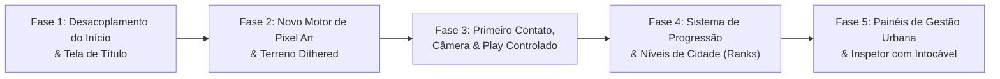

# 07 — Roteiro de Implementação e Critérios de Conclusão

> **Status do Documento:** Planejamento Oficial — Cronograma de Engenharia e Aceitação  
> **Data:** 30/10/2026  
> **Estratégia:** Implementação em 5 fases sequenciais estritamente verificáveis, onde cada etapa entrega uma versão estável e jogável do jogo sem regressões.

---

## 1. Visão Geral das Fases e Dependências

---

## 2. Detalhamento das Fases de Implementação

### Fase 1 — Desacoplamento do Fluxo Inicial, Arquitetura Online e Configuração de Mundo
- **Prioridade:** Máxima (Bloqueante para as demais).
- **Escopo Técnico:**
  1. **Servidor Online e Endpoints REST (`server.js`):**
     - Roteamento REST nativo em Node para autenticação: `POST /api/auth/login` (com credencial rápida `admin/admin`), `GET /api/auth/session`.
     - Endpoints de persistência remota: `GET /api/cities`, `GET /api/cities/:id`, `POST /api/cities`, `PUT /api/cities/:id`.
     - Armazenamento de dados em disco do servidor em `data/saves/` e `data/users.json`.
  2. **Cliente de Persistência Remota (`src/persistence/remote-storage.js`):**
     - Sincronização cliente-servidor com cache local de resiliência.
  3. **Camada de Telas (`src/ui/flow/`):**
     - Criação do `screen-manager.js` (FSM: `AUTH_SCREEN`, `TITLE_SCREEN`, `WORLD_CONFIG`, `IN_GAME`).
     - Criação do `auth-screen.js` (Login/Cadastro com atalho `admin/admin` em demo local).
     - Criação do `title-screen.js` (Menu principal, identificação do prefeito, listar cidades remotas, novo mundo).
     - Criação do `world-setup.js` (Modal com semente editável, botão de dado `[🎲]`, tamanho, bioma, dificuldade, preview procedural e opção Terreno Virgem vs Cidade Pioneira).
  4. **Desacoplamento de `src/main.js` e `src/core/state/game.js`:**
     - Eliminar criação automática de cidades no boot.
     - `starter: false` como padrão oficial de `Game`.
     - Garantir abertura do mundo estritamente em **`speed: 0`**.
- **Critérios Objetivos de Conclusão (DoD):**
  - Servidor HTTP responde aos endpoints `/api/auth/login` e `/api/cities`.
  - Autenticação com `admin/admin` funciona no cliente e recupera a sessão.
  - A página inicial não inicia simulação automática e apresenta o menu online.
  - Criar um mundo salva os dados no servidor e no cache local.
  - A mesma semente reproduz exatamente a mesma topografia.
  - O mundo abre virgem e estritamente pausado (`speed: 0`).

---

### Fase 2 — Direção de Arte e Pipeline de Pixel Art no Terreno
- **Prioridade:** Alta (Resolve a inconsistência estética diagnosticada no item 4.1).
- **Escopo Técnico:**
  1. Refatoração do rasterizador `terrTri` em `src/render/raster/terrain-texture.js`:
     - Remoção da amostragem bicúbica contínua `bil` e interpolação linear flutuante de cor.
     - Implementação da consulta à **Matriz de Bayer $4\times4$** para dithering ordenado por pixel.
     - Mapeamento da iluminação para a tabela de cores indexadas (rampas de 5 tons de verde, areia, rocha e água).
  2. Melhoria da Orla Costeira em `src/render/terrain-pass.js`:
     - Adição automática da faixa de areia amarelada dithered nos tiles de costa (`isCoast`).
     - Transição dithered com degraus em pixel art sobre a lâmina d'água.
  3. Ajuste de Falésias e Encostas Íngremes:
     - Estratos geológicos horizontais em degraus nas paredes rochosas de colinas e montanhas.
  4. Correção das Primitivas de Edifícios em `src/render/buildings/primitives.js`:
     - Correção da rotina `awning` (toldos listrados comerciais) com largura mínima em texels inteiros (sem aliasing de subpixel).
     - Texturas dithered de telhas coloniais terracota e ardósia.
- **Critérios Objetivos de Conclusão (DoD):**
  - O terreno não apresenta mais superfícies lisas ou gradientes analógicos de plástico.
  - Ao aproximar a câmera no zoom máximo, os pixels da grama, areia e água possuem quinas perfeitamente nítidas alinhadas aos texels dos edifícios.
  - Os toldos comerciais não geram mais efeito moiré ou cintilação ao mover a câmera.
  - A taxa de renderização permanece $\le 6\text{ ms}$ por quadro em mapa $48\times48$.

---

### Fase 3 — Primeiro Contato com o Mundo, Câmera e Play Controlado
- **Prioridade:** Média-Alta (Entrega a experiência guiada da Etapa 4 e 5).
- **Escopo Técnico:**
  1. Posicionamento Inteligente da Câmera na Fundação:
     - Algoritmo que localiza o centro de gravidade da maior planície contínua (`isFlat && bio === BIO.PLAIN`) e centraliza a câmera suavemente nesse ponto ao gerar o mapa.
  2. Apresentação da Mensagem de Boas-Vindas Não-Bloqueante:
     - Toast contextual no topo da tela com o convite do prefeito para instalar a primeira usina, torre d'água e vias.
  3. Destaque Visual do Botão Play:
     - O botão `Play` (`>`) da HUD pulsa suavemente quando a malha inicial viária e elétrica é detectada.
  4. Ativação Formal da Simulação:
     - Ao clicar em `Play`, a FSM transiciona para `SIMULATION_RUNNING`, liberando o acumulador de tempo, a geração de veículos civis e a evolução de canteiros de obras.
- **Critérios Objetivos de Conclusão (DoD):**
  - O jogador abre o mapa e a câmera está apontada para a melhor área plana edificável.
  - O jogador constrói uma usina solar, uma torre d'água, uma rua e duas zonas residenciais com a simulação pausada.
  - Ao apertar `Play`, os primeiros habitantes chegam e os canteiros de obras brotam de forma reativa e satisfatória.

---

### Fase 4 — Sistema de Progressão e Regras de Negócio de Crescimento
- **Prioridade:** Média (Entrega a progressão das Etapas 6 e 7 e os 3 Pilares de Zoneamento/Crescimento).
- **Escopo Técnico:**
  1. **Pilar 1 — Inflação Geométrica de Zoneamento (`src/core/tools/placement.js`):**
     - Aplicação da fórmula $C = \text{Base} \times (1 + \text{Taxa})^{Z_{\text{total}}}$ no cálculo de custo de demarcação de zonas em `cost1` e `buildPreview`.
  2. **Pilar 2 — Upgrade por Qualidade de Vida (`src/core/sim/growth.js`):**
     - Evolução de lotes de Tier 1 (Simples) para Tier 2 (Médio) e Tier 3 (Rico/Elite) com base na variável composta `qualidade_de_vida` local (valor da terra, saúde, educação, segurança, água, luz, poluição e parques).
  3. **Pilar 3 — Algoritmo de Entropia Visual / Anti-Monotonia (`src/core/sim/growth.js`):**
     - Seleção de modelos com pesos inversamente proporcionais às contagens locais ($7\times7$) e globais, assegurando distribuição arquitetônica diversificada e evitando cidades monótonas.
  4. **Criação do Sistema de Pontuação Municipal (`cityRank` e `cityPoints`) em `src/core/sim/happiness-demand.js`:**
     - Cálculo de pontos baseado na população ativa, índice de felicidade e infraestrutura atendida.
     - Definição dos 7 marcos municipais (Nível 0 a Nível 6).
  5. **Travamento Condicional no Catálogo de Construções (`src/ui/build-menu.js`):**
     - Itens avançados (Delegacia, Bombeiros, Hospital, Ônibus, Trem, Arranha-Céus) exibem ícone de cadeado e tooltip explicativo quando o nível for insuficiente.
  6. **Banner Festivo de Celebração de Novo Nível e Mostrador na HUD:**
     - Celebração visual com fanfarra de pixel art, concessão de bônus financeiro e notificação de novos serviços.
- **Critérios Objetivos de Conclusão (DoD):**
  - O custo de zonas escala suavemente no início e atinge valores exponenciais após centenas de zonas compradas.
  - Zonas sem serviços permanecem Tier 1; zonas com alta qualidade de vida atraem Tier 2 e 3.
  - Cidades densas apresentam riqueza de modelos sem repetição direta lado a lado.
  - Ao atingir 100 habitantes, a cidade sobe para Nível 1 ("Aldeia Pioneira"), liberando polícia e bombeiros.

---

### Fase 5 — Painéis de Gestão Urbana e Polimento da Interface
- **Prioridade:** Média (Complementa o controle com base nas referências `155638` a `155731`).
- **Escopo Técnico:**
  1. Expansão das Abas de Gestão Urbana em `src/ui/modals.js`:
     - Implementação das abas especializadas: Visão Geral, Gráficos Demográficos por Classe Social (Pobre, Médio, Rico), Demandas RCI 3x3, Balanço de Energia (kW), Balanço de Água (L/h) e Lista de Níveis.
  2. Inspetor de Lotes com Preservação Histórica (`#card` em `src/ui/hud.js`):
     - Exibição de habitantes/trabalhadores, felicidade detalhada, tempo de construção e causas de insatisfação.
     - Botão `[Intocável]` ([`isUntouchable`](file:///c:/Users/Carlos/Documents/gittown/Delta%20City%20plano%20revisado%20(API%20do%20TheoTown).md#L28)) funcional: impede que aquele lote sofra upgrade ou substituição automática durante a evolução da cidade.
- **Critérios Objetivos de Conclusão (DoD):**
  - Clicar em qualquer indicador da HUD abre a respectiva aba detalhada de gestão com informações precisas e sem erros no console.
  - Ao marcar um casarão residencial como "Intocável", ele nunca é demolido pela simulação de crescimento, mesmo que a demanda por arranha-céus atinja 100%.

---

## 3. Matriz de Riscos e Estratégias de Contingência

| Risco Técnico | Probabilidade | Severidade | Ação de Mitigação |
|---|---|---|---|
| **Perda de Saves Legados** | Baixa | Alta | Manter `fromJSON` tolerante a campos ausentes; se `cityRank` for indefinido, calcular retroativamente pelo tamanho da população salva. |
| **Queda de FPS com Dithering em Telas Grandes** | Baixa | Média | A matriz de Bayer $4\times4$ utiliza operações inteiras bitwise (`x & 3`, `y & 3`) que rodam em registradores de CPU sem overhead. |
| **Desbalanceamento da Curva de Pontos** | Média | Média | Concentrar os coeficientes de pontuação de nível em um arquivo de constantes isolado (`src/core/constants.js`) para calibração rápida. |
